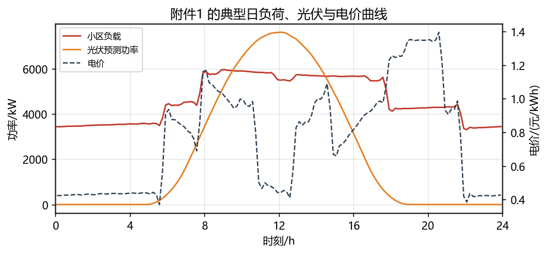
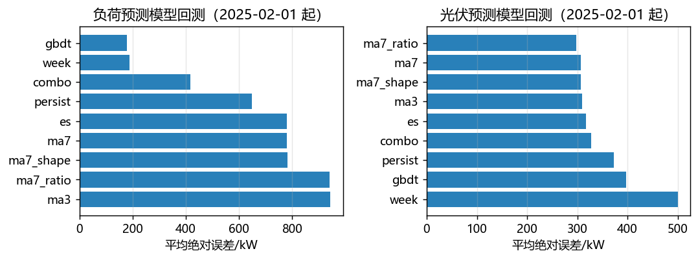
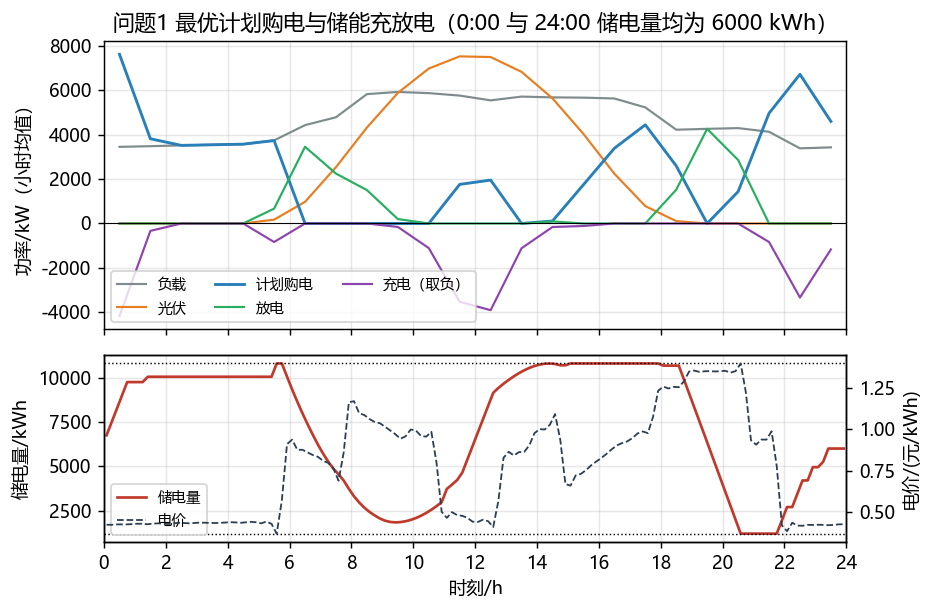
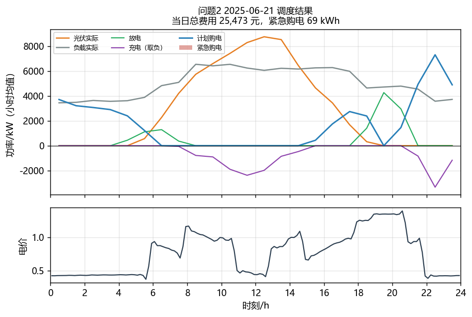
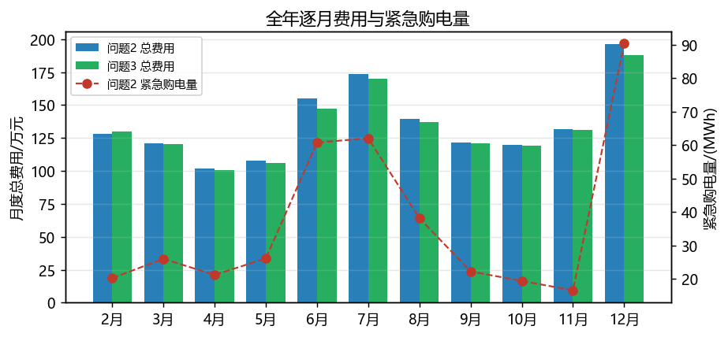
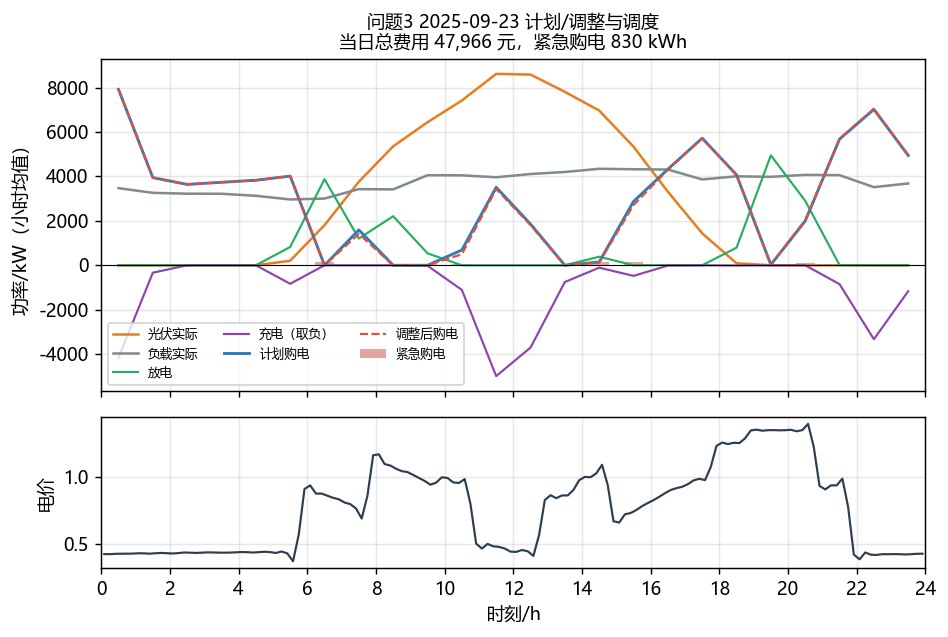
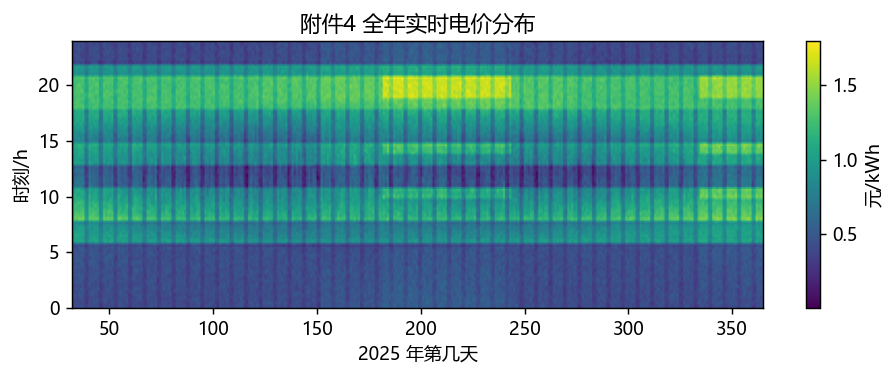
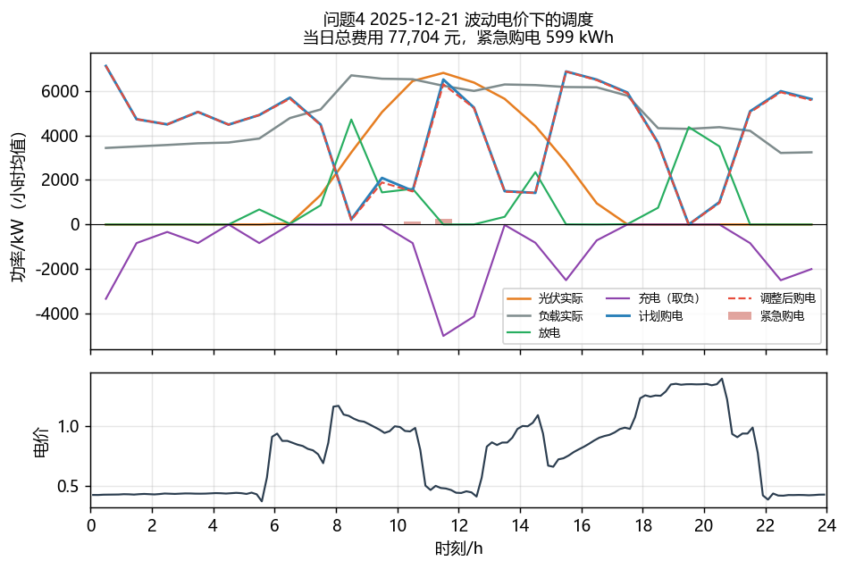
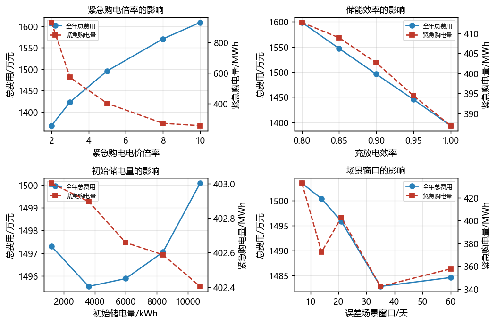

# 基于两阶段随机规划与多时刻滚动修正的购电—储能协同优化

---

## 摘要

微网通过"低价购电—储能—高价放电"的时移套利，既能就地消纳光伏、又能降低购电费用，其核心是一个带储能动态约束的**逐日滚动优化**问题。本文以 10 min 为调度时段（每日 $T=144$ 段，$\Delta t=1/6$ h），建立了统一的混合整数线性规划（MILP）框架，并针对四个问题逐步引入不确定性、滚动修正与实时电价，全部模型用 HiGHS 求解：单次优化耗时 10—40 ms，问题 3 的全年 1336 次（334 天 × 4 个预报时刻）滚动优化约需 50 s。

**针对问题 1**，以全天购电费最小为目标，建立了含 0-1 充放电互斥变量 $x_t$、储能电量递推约束、电量上下界约束和"0:00 与 24:00 储电量相同"终端约束的 MILP 模型。证明并验证了其 LP 松弛的**精确性**（LP 与 MILP 目标值均为 35 126.95 元，最优解中同时充放电功率恒为 0），从而可用线性规划高效求解。最优策略为：0:00—1:00 与 22:00—24:00 谷段满功率充电，6:00—10:00 早高峰与 18:00—21:00 晚高峰放电，11:00—14:00 光伏大发时段吸收富余电量。全天购电 **59 482.70 kWh**、购电费 **35 126.95 元**，比无储能直接购电（48 052.05 元）节省 **12 925.10 元（26.90%）**，充放电量分别为 20 740.67 kWh 和 16 799.94 kWh，储电量在 [1200, 10800] kWh 内运行且首末均为 6000 kWh。

**针对问题 2**，5 倍紧急购电价意味着计划购电存在"少买被罚、多买浪费"的风险权衡。先用预测模型滚动给出次日负荷与光伏，指出"按点预测制定计划"的确定性模型使全年紧急购电高达 951 632 kWh；进而建立**两阶段随机规划模型**：第一阶段决定计划购电与充放电（对所有误差场景共享），第二阶段在每个场景下决定紧急购电，目标为计划购电费与期望紧急购电费之和。场景由近 21 天的预测误差样本构造（21 个误差场景上的经验分布），由此自动给出**最优安全裕度**（理论临界分位数为 $1-1/k=0.8$）。全年（2025-02-01—12-31）总费用 **14 958 845.66 元**（计划购电 13 416 303.24 元 + 紧急购电 1 542 542.41 元），比确定性计划降低 1 076 114.72 元（6.71%），比无储能方案降低 8.83%，紧急购电量压至 402 657.65 kWh；与完美信息下的理论下界（12 245 046.92 元）相差 18.14%，即为预测不确定性付出的代价。

**针对问题 3**，建立了"0:00 计划 + 6/12/18 时滚动修正"的模型：以 0:00 计划为基准，购电量低于计划的部分按 0.5 倍电价计违约费、超出部分按 1.5 倍电价计价，得到**分段线性凸费用**；每次修正用新发布的光伏预报（与历史统计模型按残差协方差最优融合，权重 $w=0.358$）和已实现负荷的误差修正系数更新预测，在剩余时段上重新求解两阶段随机规划。结果表明：全年总费用 **14 697 654.75 元**（计划 13 329 050.49 + 调整附加 144 367.13 + 紧急 1 224 237.14 元），比不做调整降低 **99 028.58 元（0.67%）**；其中 **6:00 的调整贡献了全部收益的 104%**（单独使用即降至 14 693 679.20 元），12:00 与 18:00 的进一步调整收益递减、差异在 ±0.1% 内。因此**需要引入其他时刻的预报，其中 6:00 的预报最有价值**，若追求执行简洁，采用"0:00 + 6:00"两次调整即可获得几乎全部收益。

**针对问题 4**，把电价由常量序列改为附件 4 的实时波动电价，紧急购电按实时电价的 5 倍结算，其余模型结构不变。波动电价下问题 2 的总费用为 **15 702 194.30 元**（比固定电价高 4.97%），问题 3 的总费用为 **15 402 392.86 元**（高 4.79%）。费用上升的主因不是套利机会减少，而是电价波动使**缺口更集中地出现在高电价时段**：紧急购电的平均结算价由 0.7662 元/kWh 升至 0.8530 元/kWh。

最后做了模型检验与灵敏度分析：四个方案的能量守恒残差均小于 $10^{-12}$ kWh；紧急购电倍率由 2 增至 10 时，最优安全裕度随之上移、紧急购电量由 929 525 kWh 降至 257 786 kWh，全年费用单调上升 17.6%；储能效率由 0.80 提高到 1.00 使费用下降 12.8%（每提高 0.05 约降 3.2%）；场景窗口由 7 天增至 35 天使费用下降 1.4%，说明**误差样本的统计充分性比初始储电量（影响 < 0.3%）重要得多**。

**关键词**：微网调度；混合整数线性规划；两阶段随机规划；滚动修正；分段线性电价；储能套利

---

## 一、问题重述

### 1.1 问题背景

微网是为解决光伏等分布式能源本地消纳而发展起来的小型发用电系统。非孤岛式微网与外部电网相连，可以在外网电价低或分布式能源有富余时给储能充电，在电价高时放电，从而在满足小区负载的前提下尽可能节省购电费用。微网的调控对象包括：从外网的计划购电量、储能设备的充放电功率，以及在预测偏差导致供电不足时的紧急购电量。

附件给出：附件 1（某天的电价、小区负载、光伏发电预测功率，10 min 间隔共 144 点）、附件 2（2025 年全年 365 天、每天 144 点的小区负载与光伏实际功率）、附件 3（每天 0:00、6:00、12:00、18:00 发布的未来 24 个整点光伏功率预报）、附件 4（2025 年全年 144 点实时电价）、附件 5（结果文件模板）。附录 1 给出储能参数：最大容量 12 000 kWh，最大充放电功率 5000 kW，2025-01-01 0:00 储电量 6000 kWh，运行中储电量须保持在 1200—10 800 kWh，充放电效率 90%。

### 1.2 需要解决的问题

- **问题 1**：电价与小区负载每天相同，并给出光伏发电功率一天的预测数据；要求微网提供的电能不低于小区负载，且储能设备在 0:00 与 24:00 的储电量相同。建立每天 0:00 制定当天计划购电策略的数学模型，给出表 1、表 2 格式的结果并写入 `result1.xlsx`。
- **问题 2**：电价每天相同，但小区负载与光伏功率逐日变化；若微网提供的电能低于负载，需向外网紧急购电，其电价为交易时刻电价的 5 倍。建立每天 0:00 制定计划购电策略的模型，给出 2025-03-20、2025-06-21、2025-09-23、2025-12-21 四天的表 1、表 2、表 3 结果并写入 `result2.xlsx`。
- **问题 3**：每天 0:00、6:00、12:00、18:00 可获得未来 24 小时整点光伏预报，可据 0:00 预报制定计划、据其他时刻预报调整；计划购电量高于调整量的部分按交易时刻电价的 50% 计违约费，调整量高于计划量的部分按 1.5 倍电价计费；总费用包括计划购电费、紧急购电费与调整相关费用。建立模型，给出四天的结果并写入 `result3.xlsx`，并分析是否需要引入其他时刻的预报。
- **问题 4**：外网电价实时波动，用附件 4 的电价重新计算问题 2 与问题 3，结果写入 `result4-2.xlsx`、`result4-3.xlsx`。

## 二、问题分析

### 2.1 总体思路

四个问题共享同一个物理内核：**带储能动态约束的多时段购电优化**。其数学本质是

$$
\min\ \sum_{t=1}^{T} C_t\,P_{\text{grid},t}\,\Delta t
\quad\text{s.t.}\quad
\text{功率平衡} + \text{电量递推} + \text{功率/电量上下界} + \text{充放电互斥}.
$$

四个问题的差别只在于**信息结构**与**费用结构**：

| 问题 | 信息结构 | 费用结构 | 模型类型 |
|---|---|---|---|
| 1 | 单日、负荷与光伏已知 | 单一电价 | MILP（可证 LP 松弛精确） |
| 2 | 逐日、负荷与光伏需预测 | 电价 + 5 倍紧急购电 | 两阶段随机规划 |
| 3 | 逐日、0/6/12/18 时更新光伏预报 | 电价 + 0.5/1.5 倍偏差电价 + 5 倍紧急购电 | 分段线性费用的滚动随机规划 |
| 4 | 同 2、3，但电价逐时段波动 | 同 2、3（实时电价） | 同 2、3 |

因此本文采取"**一个核心模型 + 三处改造**"的技术路线：先建立问题 1 的 MILP 并证明其线性松弛的精确性（保证全年上千次求解的效率），再把"预测—决策—执行—结算"的滚动机制嵌入，最后用两阶段随机规划刻画 5 倍紧急电价带来的风险权衡。

### 2.2 各问的分析要点

**问题 1**：由于光伏在 11:00—14:00 超过负载（典型日光伏峰值 7612 kW，负载峰值 5959 kW），若不允许向电网售电，富余光伏必须由储能吸收或弃掉，这是储能充电的"零成本"来源；夜间谷段电价（约 0.43 元/kWh）与晚高峰电价（约 1.35 元/kWh）之比达 3.1，远高于储能往返效率的倒数 $1/0.81=1.235$，因此套利空间显著。0:00 与 24:00 储电量相同的约束把问题变成一个**单日周期调度**问题。

**问题 2**：关键在于 5 倍紧急购电电价。若按点预测制定计划，任何"实际负荷高于预测"或"实际光伏低于预测"的时段都会产生 5 倍电价的缺口；反之若一味多买，富余电量不退款（只按计划量计费），形成纯损失。这是一个典型的两阶段决策：**第一阶段**按期望成本最小确定计划购电量，**第二阶段**在真实偏差出现后用紧急购电弥补。在无储能的极端情形下，最优计划购电量应取净负荷预测分布的 $1-1/k=0.8$ 分位数——这为"多买一点"提供了理论依据。

**问题 3**：附件 3 的预报精度随预报时段缩短而显著提高（0:00 发布的全天预报白天时段 MAE 386.5 kW，6:00 发布的后 18 小时预报 266.2 kW，12:00 发布的后 12 小时预报 189.8 kW），因此"越晚的预报越准"；但调整要付 0.5/1.5 倍的偏差电价，且储能的充放电已在执行，故存在"调整收益 vs 调整成本"的权衡。需要用分段线性费用刻画，并以 0:00 计划为基准滚动求解。

**问题 4**：附件 4 的电价均值为 0.7575 元/kWh，与附件 1 的 0.7662 元/kWh 接近，但标准差更大（0.3360 vs 0.3133）、相邻 10 min 的平均绝对变化更大（0.0539 vs 0.0398 元/kWh），极差扩大到 0.0076—1.7936 元/kWh。这既放大了套利空间，也放大了缺口的代价。

## 三、模型假设

1. **时段离散化**：一天等分为 144 个 10 min 时段，附件 1/2/4 的第 $t$ 列（列标签 $0{:}10,0{:}20,\dots,0{:}00{+}1$）表示第 $t$ 个时段 $[10(t-1),10t)$ 分钟的数值；每时段内功率恒定，电量 = 功率 $\times \Delta t$。
2. **效率模型**：充电时 $\eta=0.9$ 的电量存入电池，放电时每取出 1 kWh 需消耗 $1/\eta$ kWh 的存储电量，即往返效率 0.81。
3. **功率上限**：充、放电功率均不超过 5000 kW，且同一时段不能同时充放电（由 0-1 变量保证）。
4. **不存在向电网售电的收益**：$P_{\text{grid}}\ge 0$，富余光伏只能充电或弃掉，富余购电量同样不退款。
5. **计划具有约束力**：计划一旦制定，购电量与充放电量按计划执行；负荷/光伏的实际偏差全部由紧急购电弥补（问题 2、3、4）。
6. **信息可得性**：每天 0:00 已知当日电价（问题 4 视为日前电价已知）、前一日的储电量、以及附件 2 中过去各日的实际负荷与光伏；问题 3 另在 6:00、12:00、18:00 获得新预报，并可读取当日已实现时段的负荷数据。
7. **可持续运行**：问题 2—4 中要求每日 24:00 的储电量不低于当日 0:00 的储电量，避免"透支"储能电量；问题 1 按题意取严格相等。
8. **不考虑储能寿命折损与网络损耗**，电价与电量单位分别为元/kWh 与 kWh。

## 四、符号说明

| 符号 | 含义 | 单位 |
|---|---|---|
| $t=1,\dots,T$ | 时段编号，$T=144$ | — |
| $\Delta t=1/6$ | 时段长度 | h |
| $C_t$ | 第 $t$ 时段电价（问题 4 为 $C_{d,t}$） | 元/kWh |
| $P^{\text{load}}_t$ | 小区负载功率 | kW |
| $P^{\text{pv}}_t$ | 光伏发电功率 | kW |
| $P^{\text{grid}}_t$ | 计划购电功率 | kW |
| $P^{\text{ch}}_t,\ P^{\text{dis}}_t$ | 充电、放电功率 | kW |
| $P^{\text{cur}}_t$ | 弃光功率 | kW |
| $P^{\text{add}}_t$ | 紧急购电功率 | kW |
| $Q_t$ | 第 $t$ 时段末的储电量（$Q_0$ 为 0:00 储电量） | kWh |
| $x_t\in\{0,1\}$ | 充放电状态变量（1 为充电，0 为放电） | — |
| $\eta$ | 充放电效率，0.9 | — |
| $P_{\max}$ | 最大充放电功率，5000 | kW |
| $E_{\min},E_{\max}$ | 储电量上下界，1200 与 10 800 | kWh |
| $E_0$ | 初始储电量，6000 | kWh |
| $k$ | 紧急购电电价倍率，$k=5$ | — |
| $S,\ \pi_s$ | 误差场景数及场景概率 $\pi_s=1/S$（$S=21$） | — |
| $\varepsilon^{L}_{s,t},\ \varepsilon^{P}_{s,t}$ | 场景 $s$ 下负荷、光伏的预测误差 | kW |
| $w$ | 附件 3 预报在光伏预测中的融合权重，0.358 | — |
| $g^{\text{plan}}_t,\ g^{\text{adj}}_t$ | 计划购电量、调整后购电量 | kW |
| $\kappa_\tau$ | 修正时刻 $\tau$ 的负荷误差修正系数 | — |

---

## 五、数据预处理与预测模型

### 5.1 数据概况

对附件数据的统计显示（表 1）：附件 1 的电价、负载、光伏三列的均值分别为 0.7662 元/kWh、4626.03 kW、2311.78 kW，与附件 2、附件 4 全年 144 列的逐列均值完全一致，说明**附件 1 给出的就是 2025 年的"典型日"**（各时段年均值），这与问题 1"每天的电价和小区负载相同"的设定吻合。

**表 1  附件数据的基本统计**

| 数据 | 维度 | 最小值 | 最大值 | 均值 |
|---|---|---|---|---|
| 附件 1 电价 | 144 | 0.3713 | 1.3952 | 0.7662 |
| 附件 1 负载 / kW | 144 | 3309.4 | 5959.0 | 4626.0 |
| 附件 1 光伏 / kW | 144 | 0.0 | 7612.3 | 2311.8 |
| 附件 2 负载 / kW | $365\times144$ | 1995.7 | 7978.9 | 4626.0 |
| 附件 2 光伏 / kW | $365\times144$ | 0.0 | 10216.2 | 2311.8 |
| 附件 3 预报 / kW | $365\times4\times24$ | 0.0 | 9995.9 | — |
| 附件 4 电价（2—12 月） | $334\times144$ | 0.0076 | 1.7936 | 0.7575 |

2025-02-01 至 12-31 共 334 天的总负载电量为 **3700.8 万 kWh**，光伏发电量 **1906.9 万 kWh**，净负荷 **1793.9 万 kWh**；全年有 330 天存在"光伏瞬时功率超过负载"的时段，即弃光/充电压力是常态。



**图 1** 中电价呈现明显的"谷—峰—谷—峰"结构：0:00—5:00 约 0.42—0.44 元/kWh，6:00—10:00 早高峰（峰值 1.08），11:00—14:00 因光伏大发回落到 0.44—0.53，18:00—21:00 晚高峰最高（峰值 1.3952），22:00 后回到 0.42。光伏峰值出现在 12:00 前后（7612 kW），而负载在 8:00—17:00 基本维持在 5600—5950 kW 的平台，因此 10:30—14:00 光伏可覆盖负载并有 1100—1950 kW 的富余，这正是储能充电的最佳窗口。

### 5.2 时段与口径的统一

附件 1/2/4 的 144 列标签为 $0{:}10,0{:}20,\dots,23{:}50,0{:}00{+}1$，即"区间末端时刻"，第 $t$ 列对应第 $t$ 个 10 min 时段；结果模板 `result1.xlsx` 的 144 行时间标签整体比数据列后移一格（首行为 `0:10-0:20`、末行为 `0:00+1-0:10+1`）。本文按**列序一一对应**填写：模板第 $t$ 行的购电量即第 $t$ 个时段 $[10(t-1),10t)$ 的购电量，故模板标签的起点可理解为该时段的结束时刻。

对附件 3，本文以实际数据校验了预报口径：把 0:00 发布的第 $k$ 个预报值与当天 $k{:}00$ 的整点实际值比对，平均绝对误差 181.3 kW；若解释为"第 $k$ 个小时的时段平均值"则误差为 340.6 kW，故确认 **`预报k小时` 表示发布时刻之后第 $k$ 个整点的点值**；进一步对发布日偏移 $-1,0,+1$ 做检验，偏移为 0 时四种发布时刻的误差均最小，故对齐方式无误。整点预报降尺度到 10 min 时采用**按时钟线性插值**（0:00 取 0），其白天时段 MAE 为 386.5 kW，明显优于分段常数（727.9 kW）。

### 5.3 负荷预测模型与选型

问题 2 起需要每天 0:00 预测当日 144 点的负荷。为保证"只用历史信息"，构造了 9 个候选模型并在 2025-02-01 起的 334 天上滚动回测（每天用该日之前的数据预测该日）：

- `persist`：持续法，取前一日同时段值；
- `ma3/ma7`：前 3/7 日同时段均值；
- `week`：同星期几前 4 周均值；
- `es`：同时段序列的指数平滑（$\alpha=0.6$）；
- `ma7_shape`：近 7 日归一化日形状 $\times$ 近 7 日日电量均值；
- `ma7_ratio`：`ma7` 乘以"近 3 日 / 近 7 日日电量比"的修正系数（截断于 $[0.85,1.15]$）；
- `gbdt`：梯度提升树（`HistGradientBoosting`，200 棵、学习率 0.08、深度 6），特征为时刻的正弦/余弦编码、年周期、星期、前 1/2/3/7 日同时段功率、前一日与前 7 日均值，每 30 天滚动重训；
- `combo`：`ma7_shape` 与 `gbdt` 的等权平均。

**表 2  负荷与光伏预测模型的滚动回测结果（2025-02-01 起 334 天）**

| 模型 | 负荷 MAE/kW | 负荷 MAPE | 负荷 RMSE/kW | 光伏 MAE/kW | 光伏 MAPE | 光伏 RMSE/kW |
|---|---|---|---|---|---|---|
| persist | 650.0 | 15.97% | 1128.4 | 372.3 | 7.70% | 531.9 |
| ma3 | 945.1 | 23.58% | 1241.3 | 310.0 | 6.41% | 444.4 |
| ma7 | 781.2 | 19.66% | 955.9 | 307.4 | 6.37% | 430.7 |
| week | 188.9 | 4.22% | 262.1 | 499.9 | 10.74% | 632.1 |
| es | 780.4 | 19.50% | 1119.5 | 317.8 | 6.57% | 455.3 |
| ma7_shape | 783.1 | 19.69% | 957.6 | 307.4 | 6.38% | 430.8 |
| ma7_ratio | 942.0 | 23.50% | 1197.3 | **297.4** | **6.15%** | **421.6** |
| gbdt | **178.0** | **3.93%** | 280.8 | 842.9 | 17.51% | 1093.7 |
| combo | 418.0 | 10.43% | 525.6 | 522.9 | 10.89% | 660.1 |

结论：**负荷宜用梯度提升树**（MAE 178.0 kW、MAPE 3.93%，较持续法降低 72.6%），说明负荷具有较强的"周周期 + 年周期"结构，树木模型能同时刻画两种周期；**光伏宜用 `ma7_ratio` 气候学型模型**（白天时段 MAE 297.4 kW），因为光伏受云量影响、逐日随机性强，机器模型反而过拟合历史样本（GBDT 的 MAE 达 842.9 kW）。



### 5.4 光伏预测：附件 3 预报与融合

问题 3 起可以使用附件 3 的整点预报。按各发布时刻覆盖的时段分别评估精度（表 3）可见：**预报时段越短越准**——0:00 发布的全天预白天 MAE 386.5 kW、覆盖时段电量偏差 3019 kWh；6:00 发布的后 18 小时降到 266.2 kW / 1732 kWh；12:00 发布的后 12 小时进一步降到 189.8 kW / 575 kWh。

**表 3  附件 3 预报与历史统计模型的精度对比（白天时段）**

| 预测源 | 覆盖时段 | 10 min MAE/kW | 覆盖时段电量偏差/kWh |
|---|---|---|---|
| 附件 3（0:00 发布） | 全天 24 h | 386.5 | 3019 |
| 附件 3（6:00 发布） | 后 18 h | 266.2 | 1732 |
| 附件 3（12:00 发布） | 后 12 h | 189.8 | 575 |
| 历史统计 `ma7_ratio` | 全天 24 h | 297.4 | 2033 |

值得注意的是，附件 3 的全天预报精度（386.5 kW）**低于**历史气候学模型（297.4 kW），但二者的误差相关性很弱（$\rho=0.176$），说明二者信息互补。设融合预测

$$
\hat P^{\text{pv}}_t = w\,P^{\text{fc}}_t + (1-w)\,P^{\text{hist}}_t ,
$$

由残差方差最小化得最优权重

$$
w^\ast=\frac{\sigma_h^2-\rho\sigma_f\sigma_h}{\sigma_f^2+\sigma_h^2-2\rho\sigma_f\sigma_h}=0.358
\quad(\sigma_f=536.3,\ \sigma_h=421.6,\ \rho=0.176),
$$

回测 MAE 由 386.5 kW（纯预报）/297.4 kW（纯统计）降至 **255.9 kW**（相对最优单模型降低 13.9%）。故问题 3、4 的光伏预测采用该融合模型；问题 2 按题意只能使用附件 1、2，故采用 `ma7_ratio`。

### 5.5 预测误差的场景刻画

两阶段随机规划需要误差的经验分布。以近 $W=21$ 天的**逐日误差向量** $\varepsilon^{L}_{s,\cdot}=P^{\text{load}}-\hat P^{\text{load}}$、$\varepsilon^{P}_{s,\cdot}=P^{\text{pv}}-\hat P^{\text{pv}}$ 作为 21 个等概率场景。这样既保留了误差在一天之内的时序相关性（如午后云量整体偏低），又能自动反映误差的均值（预测偏高/偏低）与尾部风险。$W$ 的取值在第十节做灵敏度分析。

---

## 六、问题 1：计划购电策略的 MILP 模型

### 6.1 模型建立

**核心模型汇总**（每式一行，即问题 1 的完整数学模型）：

$$
\begin{aligned}
\min\;& Z_1=\sum_{t=1}^{144} C_t\,P^{\text{grid}}_t\,\Delta t\\
\text{s.t.}\;&\left\{
\begin{aligned}
& P^{\text{pv}}_t-P^{\text{cur}}_t+P^{\text{dis}}_t-P^{\text{ch}}_t+P^{\text{grid}}_t=P^{\text{load}}_t, && t=1,\dots,144\\
& Q_t=Q_{t-1}+\Big(\eta P^{\text{ch}}_t-\frac{P^{\text{dis}}_t}{\eta}\Big)\Delta t, && t=1,\dots,144\\
& 0\le P^{\text{ch}}_t\le P_{\max}\,x_t,\qquad 0\le P^{\text{dis}}_t\le P_{\max}\,(1-x_t), && t=1,\dots,144\\
& 0\le P^{\text{cur}}_t\le P^{\text{pv}}_t,\qquad P^{\text{grid}}_t\ge 0, && t=1,\dots,144\\
& 1200\le Q_t\le 10800, && t=0,1,\dots,144\\
& Q_0=Q_{144}=6000\\
& x_t\in\{0,1\}, && t=1,\dots,144
\end{aligned}
\right.
\end{aligned}
$$

其中 $T=144$、$\Delta t=1/6$ h、$P_{\max}=5000$ kW、$\eta=0.9$，$C_t,P^{\text{load}}_t,P^{\text{pv}}_t$ 取附件 1 的第 $t$ 个时段值。下面逐项说明模型构成与参数取值。

**决策变量**：$P^{\text{grid}}_t,\ P^{\text{ch}}_t,\ P^{\text{dis}}_t,\ P^{\text{cur}}_t\ (t=1,\dots,144)$、$Q_t\ (t=0,\dots,144)$、$x_t\in\{0,1\}$。

**目标函数**：极小化全天购电费

$$
\min\ Z_1=\sum_{t=1}^{144} C_t\,P^{\text{grid}}_t\,\Delta t .
$$

**约束条件**：

（1）功率平衡（微网提供的电能恰好满足负载，不低于负载）：

$$
P^{\text{pv}}_t-P^{\text{cur}}_t+P^{\text{dis}}_t-P^{\text{ch}}_t+P^{\text{grid}}_t=P^{\text{load}}_t,\qquad t=1,\dots,144;
$$

（2）储能电量递推（充放电效率 0.9）：

$$
Q_t=Q_{t-1}+\Big(\eta P^{\text{ch}}_t-\frac{P^{\text{dis}}_t}{\eta}\Big)\Delta t,\qquad t=1,\dots,144;
$$

（3）充放电功率上限与互斥（$x_t$ 为 0-1 变量）：

$$
0\le P^{\text{ch}}_t\le P_{\max}x_t,\qquad
0\le P^{\text{dis}}_t\le P_{\max}(1-x_t),\qquad x_t\in\{0,1\};
$$

（4）购电、弃光的非负与上限：

$$
P^{\text{grid}}_t\ge 0,\qquad 0\le P^{\text{cur}}_t\le P^{\text{pv}}_t ;
$$

（5）储电量上下界：

$$
E_{\min}\le Q_t\le E_{\max},\qquad t=0,1,\dots,144 ;
$$

（6）初末储电量（0:00 与 24:00 相同）：

$$
Q_0=Q_{144}=E_0=6000\ \text{kWh}.
$$

其中 $P_{\max}=5000$ kW，$E_{\min}=1200$ kWh，$E_{\max}=10800$ kWh，$C_t$ 取附件 1 的电价，$P^{\text{load}}_t,P^{\text{pv}}_t$ 取附件 1 的负载与光伏预测功率。

这是一个含 144 个 0-1 变量、约 865 个连续变量的 MILP。**关于 LP 松弛的精确性**：由于所有电价为正，最优解中必有 $P^{\text{ch}}_tP^{\text{dis}}_t=0$（同时充放只会额外损失 $(1-\eta^2)$ 的电量而不改善任何约束），故把 $x_t$ 松弛为 $[0,1]$ 后最优值不变。这一点在 6.2 节被数值验证，因此全年上千次求解都可以用线性规划完成。

> 说明：为保证严格可行，模型中保留了弃光变量 $P^{\text{cur}}_t$（当光伏瞬时功率超过"负载 + 最大充电功率"时必须弃光）；最优解中 $P^{\text{cur}}\equiv 0$，即典型日的富余光伏全部被储能吸收。

### 6.2 求解与松弛精确性验证

用 SciPy 的 HiGHS 求解器分别求解 MILP 与 LP 松弛，结果完全一致：

| 项目 | MILP | LP 松弛 |
|---|---|---|
| 目标值/元 | 35 126.9486 | 35 126.9486 |
| 求解时间/s | 0.030 | 0.011 |
| $\max_t\min(P^{\text{ch}}_t,P^{\text{dis}}_t)$/kW | 0.000000 | 0.000000 |

目标值相同且最优解中同时充放电功率恒为 0，**验证了 LP 松弛的精确性**。

### 6.3 计算结果

**表 4  问题 1 指定时段的购电量及全天购电量与购电费**

| 时间段 | 购电量/kWh | 时间段 | 购电量/kWh | 时间段 | 购电量/kWh |
|---|---|---|---|---|---|
| 10:00-10:10 | 0.0000 | 12:00-12:10 | 480.4124 | 14:00-14:10 | 0.0000 |
| 16:00-16:10 | 445.4317 | 18:00-18:10 | 531.8940 | 20:00-20:10 | 0.0000 |

**全天购电量 = 59 482.70 kWh，全天购电费 = 35 126.95 元。**

**表 5  问题 1 储能设备分时充放电量与储电量**

| 时间段 | 充电量/kWh | 放电量/kWh | 时段末储电量/kWh |
|---|---|---|---|
| 0:00-4:00 | 4500.00 | 0.00 | 10 050.00 |
| 4:00-8:00 | 833.33 | 6365.84 | 3726.84 |
| 8:00-12:00 | 4787.96 | 1703.00 | 6143.79 |
| 12:00-16:00 | 5286.04 | 91.10 | 10 800.00 |
| 16:00-20:00 | 0.00 | 5780.13 | 4377.63 |
| 20:00-24:00 | 5333.33 | 2859.87 | 6000.00 |
| **0:00 储电量** | **6000.00** | **24:00 储电量** | **6000.00** |

全天充电 20 740.67 kWh、放电 16 799.94 kWh，二者之比 0.810 恰为往返效率；**购电量 59 482.70 kWh = 净负荷（111 025.00 − 55 483.03 = 55 541.97 kWh）+ 储能损耗（20 740.67 − 16 799.94 = 3940.73 kWh）**，能量完全闭合（误差 < $10^{-9}$ kWh），说明模型与数据口径一致。

**表 6  问题 1 最优策略的经济性对比**

| 方案 | 全天购电量/kWh | 全天购电费/元 | 相对无储能 |
|---|---|---|---|
| 无储能直接购电（富余光伏弃掉） | 61 789.94 | 48 052.05 | — |
| 本文最优策略 | 59 482.70 | **35 126.95** | **−12 925.10 元（−26.90%）** |

无储能时，11:00—14:00 约 6248 kWh 的富余光伏被白白弃掉，同时晚高峰必须全价购电，故其购电量（61 789.94 kWh）反而比配置储能后（59 482.70 kWh）更多；储能同时实现了"少买"与"买得便宜"两重收益。



由图 2 可见最优策略的清晰结构：

- **0:00—1:00**：电价 0.42—0.43 元/kWh，以 5000 kW 满功率充电（储电量由 6000 升至 10 050 kWh）；
- **5:40—10:00**：电价进入早高峰（0.8—1.08 元/kWh），储能放电覆盖负载，购电降为 0；
- **10:30—13:10**：光伏超过负载且电价回落到 0.44—0.53 元/kWh，用富余光伏 + 低价购电把储能充满至 10 800 kWh；
- **13:30—15:00**：电价回到 0.86—1.09 元/kWh，继续少量放电；
- **18:00—21:00**：晚高峰电价 1.25—1.3952 元/kWh，储能满功率放电，储电量由 10 800 降至 1200 kWh（下限）；
- **22:00—24:00**：电价回落至 0.42 元/kWh，再次充电，24:00 回到 6000 kWh。

值得注意的是，12:00—12:10、16:00—16:10、18:00—18:10 三个指定时段仍有购电（480.41/445.43/531.89 kWh），原因分别是"光伏富余时段仍以低价购电充电"和"晚间高峰储能已放空后的必要购电"，符合经济直觉。


---

## 七、问题 2：5 倍紧急电价下的日滚动两阶段随机规划

### 7.1 不确定性带来的新问题

问题 2 中电价固定为附件 1 的各时段值，但负荷与光伏逐日变化。每天 0:00 只能用预测值制定计划，而计划的**购电量与充放电量一旦确定就要执行**；若执行时"光伏 + 放电 + 计划购电"不足以覆盖实际负荷，缺口必须按交易时刻电价的 **5 倍**紧急购电。于是出现两个方向的风险：

- 计划买少了：缺口按 5 倍电价结算，代价极高；
- 计划买多了：富余电量按计划价付了钱却用不掉（不能上网、不退款），是纯损失。

因此问题 2 的核心不是"算得准"，而是**在 1 倍与 5 倍的价差下确定一个最优的安全裕度**。

### 7.2 确定性模型及其缺陷

按题目字面（也是常见做法）可先建立确定性 MILP：

$$
\begin{aligned}
\min\ & Z_2=\sum_{t=1}^{144}C_t\big(P^{\text{grid}}_t+kP^{\text{add}}_t\big)\Delta t\\
\text{s.t.}\ & P^{\text{pv}}_t-P^{\text{cur}}_t+P^{\text{dis}}_t-P^{\text{ch}}_t+P^{\text{grid}}_t+P^{\text{add}}_t=P^{\text{load}}_t,\\
& Q_t=Q_{t-1}+\Big(\eta P^{\text{ch}}_t-\frac{P^{\text{dis}}_t}{\eta}\Big)\Delta t,\quad
0\le P^{\text{ch}}_t\le P_{\max}x_t,\ 0\le P^{\text{dis}}_t\le P_{\max}(1-x_t),\\
& E_{\min}\le Q_t\le E_{\max},\quad Q_{144}\ge Q_0,\quad x_t\in\{0,1\},
\end{aligned}
$$

其中 $P^{\text{add}}_t$ 是紧急购电功率，$k=5$。**这个模型有一个致命的退化**：由于模型内部的负荷与光伏都是点预测（单一确定值），只要 $P^{\text{add}}_t$ 取 0 就能满足平衡，最优解中 $P^{\text{add}}\equiv 0$，安全裕度恒为零——模型看不出"未来会预测错误"。

用该模型滚动求解全年（2025-02-01—12-31，334 天，$Q_0=6000$ kWh 逐日传递），按实际负荷与光伏结算后得到：

| 指标 | 数值 |
|---|---|
| 全年总费用 | 16 034 960.38 元 |
| 计划购电量 / 计划购电费 | 20 309 106 kWh / 12 293 845.81 元 |
| 紧急购电量 / 紧急购电费 | **951 632 kWh / 3 741 114.56 元（占 23.3%）** |
| 富余（弃用）电量 | 2 035 839 kWh |

即"零裕度"计划把近四分之一的费用交给了 5 倍电价的紧急购电，说明必须显式刻画预测误差。

### 7.3 两阶段随机规划模型

引入误差场景 $\omega\in\Omega=\{1,\dots,S\}$，概率 $\pi_\omega=1/S$（$S=21$），场景 $\omega$ 在第 $t$ 时段的负荷与光伏误差为 $\varepsilon^{L}_{\omega,t},\varepsilon^{P}_{\omega,t}$。**第一阶段**变量 $P^{\text{grid}}_t,P^{\text{ch}}_t,P^{\text{dis}}_t,Q_t,x_t$ 对所有场景共享（即日前计划）；**第二阶段**变量 $P^{\text{add}}_{\omega,t}\ge0$ 是场景 $\omega$ 下的应急购电（追索决策）。**核心模型汇总**（每式一行）：

$$
\begin{aligned}
\min\;& Z_3=\sum_{t=1}^{144}C_t\,\Delta t\,\Big(P^{\text{grid}}_t+k\sum_{\omega\in\Omega}\pi_\omega P^{\text{add}}_{\omega,t}\Big)\\
\text{s.t.}\;&\left\{
\begin{aligned}
& Q_t=Q_{t-1}+\Big(\eta P^{\text{ch}}_t-\frac{P^{\text{dis}}_t}{\eta}\Big)\Delta t, && t=1,\dots,144\\
& 1200\le Q_t\le 10800,\qquad Q_0=6000,\qquad Q_{144}\ge Q_0, && t=1,\dots,144\\
& 0\le P^{\text{ch}}_t\le P_{\max}\,x_t,\qquad 0\le P^{\text{dis}}_t\le P_{\max}\,(1-x_t), && t=1,\dots,144\\
& P^{\text{grid}}_t-P^{\text{ch}}_t+P^{\text{dis}}_t+P^{\text{add}}_{\omega,t}\ \ge\ \hat P^{\text{load}}_t+\varepsilon^{L}_{\omega,t}-\hat P^{\text{pv}}_t-\varepsilon^{P}_{\omega,t}, && \forall\,\omega,t\\
& P^{\text{grid}}_t\ge 0,\qquad P^{\text{add}}_{\omega,t}\ge 0, && \forall\,\omega,t\\
& x_t\in\{0,1\}, && t=1,\dots,144
\end{aligned}
\right.
\end{aligned}
$$

三点说明：

1. **平衡约束取"$\ge$"而非"$=$"**。第一阶段的购电量是承诺量，实际用不完的部分被弃掉（已付费、不退款），因此供给能力只需"不小于"需求；这一处不等号正是风险对冲能够起作用的关键——若写成等式，多买的电无处可去，模型就无法表达"多买"。弃光也被这一不等号自动包含（光伏多时少用即可）。
2. **追索只作用在紧急购电上**。由于计划对购电量与充放电量都有约束力（假设 5），储能的充放电属第一阶段；场景只影响缺口大小。
3. **无储能时的最优裕度可解析给出**。记净负荷预测误差 $\xi=(P^{\text{load}}-\hat P^{\text{load}})-(P^{\text{pv}}-\hat P^{\text{pv}})$（即"实际净负荷 − 预测净负荷"），分布函数为 $F$，则时段期望费用为 $C_t\Delta t\,g+kC_t\Delta t\,\mathbb{E}\big[(\xi+\hat P^{\text{load}}_t-\hat P^{\text{pv}}_t-g)^+\big]$，对 $g$ 求导并令其为零得 $F\big(g^\ast-\hat P^{\text{load}}_t+\hat P^{\text{pv}}_t\big)=1-1/k=0.8$，即**计划购电量应取净负荷的 80% 分位数**（正态近似下为"多买 $0.84\sigma$"）。含储能与时段耦合时，这一结论推广为"由优化自动决定的时变裕度"，无需人工设定。

**场景构造**：取近 $W=21$ 天的逐日误差向量 $\{\varepsilon^{L}_{s,\cdot},\varepsilon^{P}_{s,\cdot}\}_{s=1}^{21}$ 作为 21 个等概率场景。取日级误差向量而非独立同分布抽样，可以保留"午后整体偏阴""某日负荷整体偏高"这类**日内相关性**，这对储能跨时段调度至关重要。问题 2 的光伏预测用 `ma7_ratio`（只用附件 1、2），负荷预测用 GBDT。

### 7.4 滚动求解算法

```
输入：附件1 电价 C、附件2 实际负荷 L、实际光伏 P、预测模型 fL、fP、初始储电量 E0
for d = 2025-02-01 .. 2025-12-31:            # 334 天
    1) 预测：L̂ ← fL(历史),  P̂ ← fP(历史)
    2) 场景：取近 21 天误差 {(L-L̂), (P-P̂)}
    3) 求解两阶段随机规划 → P_grid, P_ch, P_dis, Q（全天 144 段）
    4) 执行并按实际结算：
         缺口 P_add(t) = max{0, L(t) - P(t) - P_dis(t) + P_ch(t) - P_grid(t)}
         费用 = Σ_t C_t Δt [P_grid(t) + 5 P_add(t)]
    5) 结转：Q0 ← Q_144
```

模型规模：第一阶段 $6\times144+145=1009$ 个连续变量 + 144 个 0-1 变量，第二阶段 $21\times144=3024$ 个追索变量，合计约 4200 个变量、3168 条约束；单次求解在 HiGHS 上耗时约 35 ms，全年 334 次约 12 s。

### 7.5 计算结果

全年（2025-02-01—12-31）结果如表 7。

**表 7  问题 2 全年结果（334 天）**

| 指标 | 数值 |
|---|---|
| 全年总费用 | **14 958 845.66 元** |
| 计划购电费 | 13 416 303.24 元 |
| 紧急购电费（占 10.3%） | 1 542 542.41 元 |
| 计划购电量 | 22 026 080.77 kWh（平均购电单价 0.6091 元/kWh） |
| 紧急购电量 | 402 657.65 kWh |
| 充电量 / 放电量 | 6 961 316.39 / 5 638 666.28 kWh |
| 富余（弃用）电量 | 3 166 898.81 kWh |
| 日均费用 | 44 786.96 元 |
| 最高 / 最低单日费用 | 142 962 元（12-31）/ 13 951 元（04-25） |

平均购电单价 0.6091 元/kWh，比全年平均电价 0.7662 元/kWh 低 20.5%，说明"低价多买、高价少买"的时移套利效果显著。

**表 8  问题 2 指定日期的购电量（表 1 格式）**

| 日期 | 10:00-10:10 | 12:00-12:10 | 14:00-14:10 | 16:00-16:10 | 18:00-18:10 | 20:00-20:10 | 全天购电量/kWh | 全天购电费/元 |
|---|---|---|---|---|---|---|---|---|
| 2025-03-20 | 0.0000 | 553.5952 | 0.0000 | 485.2185 | 713.2252 | 0.0000 | 68 306.02 | 41 243.74 |
| 2025-06-21 | 0.0000 | 0.0000 | 0.0000 | 280.2557 | 520.8556 | 0.0000 | 42 445.24 | 25 320.77 |
| 2025-09-23 | 0.0000 | 479.2794 | 0.0000 | 571.3147 | 767.8679 | 0.0000 | 71 235.59 | 44 316.31 |
| 2025-12-21 | 0.0000 | 984.3901 | 0.0000 | 851.2350 | 735.9318 | 0.0000 | 100 083.59 | 64 279.79 |

**表 9  问题 2 指定日期的储能充放电量与储电量（表 2 格式，单位 kWh）**

| 日期 | 0:00-4:00 充/放 | 4:00-8:00 充/放 | 8:00-12:00 充/放 | 12:00-16:00 充/放 | 16:00-20:00 充/放 | 20:00-24:00 充/放 | 0:00 储电量 | 24:00 储电量 |
|---|---|---|---|---|---|---|---|---|
| 2025-03-20 | 4500.00 / 0.00 | 833.33 / 5639.77 | 5901.94 / 3000.23 | 5126.55 / 293.08 | 0.00 / 5690.67 | 5333.33 / 2949.33 | 6000.00 | 6000.00 |
| 2025-06-21 | 0.00 / 0.00 | 53.82 / 3220.45 | 5954.60 / 0.00 | 3300.78 / 0.00 | 0.00 / 5676.24 | 5333.33 / 2963.76 | 6000.00 | 6000.00 |
| 2025-09-23 | 4500.00 / 0.00 | 833.33 / 5636.17 | 6192.96 / 3003.83 | 4744.86 / 219.63 | 0.00 / 5743.04 | 5333.33 / 2896.96 | 6000.00 | 6000.00 |
| 2025-12-21 | 4500.00 / 0.00 | 1666.67 / 1508.33 | 5833.33 / 7806.67 | 8199.74 / 2726.79 | 0.00 / 5661.30 | 5333.33 / 2978.70 | 6000.00 | 6000.00 |

**表 10  问题 2 指定日期的紧急购电（表 3 格式）**

| 日期 | 紧急购电时段与电量/kWh | 合计/kWh | 费用/元 |
|---|---|---|---|
| 2025-03-20 | 0:20-0:40（36.69）；1:00-1:40（98.70）；3:00-4:00（107.37）；4:50-5:20（42.37）；5:50-6:00（2.03）；8:10-8:30（76.65） | 1168.41 | 4454.03 |
| 2025-06-21 | 1:20-1:30（20.78）；3:00-3:30（27.25）；3:50-4:10（17.01）；5:30-5:40（2.47）；6:10-6:20（1.36） | 68.88 | 151.92 |
| 2025-09-23 | 0:40-0:50（12.38）；1:00-1:10（4.47）；2:00-2:20（26.72）；4:50-5:20（26.89）；6:20-6:30（1.09）；6:50-7:00（6.75） | 974.67 | 4144.66 |
| 2025-12-21 | 3:00-3:10（2.42）；3:30-3:50（43.91）；10:30-11:30（379.96）；15:20-15:30（7.75）；18:10-18:20（7.20）；18:30-19:10（34.23） | 534.83 | 1889.33 |

四天的紧急购电量占比分别为 1.7%、0.16%、1.4%、0.53%，紧急购电集中出现在**凌晨 0:00—6:00**（此时储能在谷段充电、计划购电量按"负载 + 充电 − 光伏"确定，一旦负荷预测偏低立即形成缺口）与**上午 10:30—11:30**（光伏预报偏高的时段）。12 月 21 日的总费用（66 169 元）显著高于其他三天，因为该日负载最大（日购电量 100 084 kWh）且光伏最弱。



### 7.6 与确定性模型、理论下界的对比

**表 11  问题 2 的费用对比**

| 方案 | 总费用/元 | 计划购电费/元 | 紧急购电费/元 | 紧急购电量/kWh | 相对本文模型 |
|---|---|---|---|---|---|
| 确定性计划（7.2 节） | 16 034 960.38 | 12 293 845.81 | 3 741 114.56 | 951 632 | +1 076 114.72（+7.19%） |
| **本文两阶段随机规划** | **14 958 845.66** | 13 416 303.24 | 1 542 542.41 | 402 658 | — |
| 无储能、实际光伏（基准） | 16 407 319.63 | — | — | — | +1 448 473.97（+9.68%） |
| 完美信息（理论下界） | 12 245 046.92 | 12 245 046.92 | 0.00 | 0 | −2 713 798.74（−18.14%） |

三点结论：

1. **风险对冲的价值**：两阶段模型多花 1 122 457 元计划购电费（+9.1%），却少花 2 198 572 元紧急购电费（−58.8%），净省 1 076 115 元（6.71%），紧急购电量减少 57.7%。这印证了 7.3 节的分位数结论——在 5 倍罚金下"多买"是合算的。
2. **储能的价值**：与"无储能 + 实际光伏"相比节省 1 448 474 元（8.83%），但远小于完美信息下的 4 161 919 元潜力，说明**预测精度的边际价值大于储能容量的边际价值**（第十节灵敏度分析进一步支持这一点）。
3. **不确定性的代价**：完美信息下界 12 245 046.92 元与本文结果相差 18.14%，这部分即为负荷/光伏预测误差的"信息成本"；若能把预测误差降低一半，按灵敏度分析可回收其中相当一部分。

**表 12  问题 2 月度结果**

| 月份 | 天数 | 总费用/元 | 计划购电量/kWh | 紧急购电量/kWh | 紧急购电费/元 | 日均费用/元 |
|---|---|---|---|---|---|---|
| 2 月 | 28 | 1 283 276 | 1 992 072 | 20 203 | 73 513 | 45 831.28 |
| 3 月 | 31 | 1 209 975 | 1 876 078 | 25 972 | 94 935 | 39 031.46 |
| 4 月 | 30 | 1 016 808 | 1 623 326 | 21 157 | 76 285 | 33 893.60 |
| 5 月 | 31 | 1 075 287 | 1 646 069 | 26 082 | 104 035 | 34 686.69 |
| 6 月 | 30 | 1 550 144 | 2 120 446 | 60 739 | 236 665 | 51 671.46 |
| 7 月 | 31 | 1 737 543 | 2 423 545 | 61 991 | 225 518 | 56 049.77 |
| 8 月 | 31 | 1 392 001 | 2 005 486 | 38 134 | 146 351 | 44 903.26 |
| 9 月 | 30 | 1 214 899 | 1 840 305 | 22 192 | 82 485 | 40 496.63 |
| 10 月 | 31 | 1 200 242 | 1 862 597 | 19 360 | 79 524 | 38 717.47 |
| 11 月 | 30 | 1 317 615 | 2 056 543 | 16 555 | 56 882 | 43 920.51 |
| 12 月 | 31 | 1 961 055 | 2 579 615 | 90 272 | 366 350 | 63 259.85 |

月度费用呈"双峰"形态：6—7 月（制冷负荷高、光伏占比大但波动强）与 12 月（采暖负荷最高、光伏最弱）为两个高峰，4—5 月与 9—10 月最低。



---

## 八、问题 3：多时刻预报下的滚动修正模型

### 8.1 修正机制与费用结构

问题 3 允许在 6:00、12:00、18:00 用新发布的光伏预报调整当日剩余时段的购电策略，并对"计划"与"调整"的偏差收费。设 $g^{\text{plan}}_t$ 为 0:00 制定的计划购电量，$g^{\text{adj}}_t$ 为最终执行的调整购电量，则第 $t$ 时段的购电费用为分段线性凸函数

$$
f_t(g)=\begin{cases}
C_t\,g+0.5\,C_t\,(g^{\text{plan}}_t-g), & g\le g^{\text{plan}}_t,\\[2pt]
C_t\,g^{\text{plan}}_t+1.5\,C_t\,(g-g^{\text{plan}}_t), & g>g^{\text{plan}}_t,
\end{cases}
$$

即：低于计划的部分按 0.5 倍电价计违约费（本应支付的差额被折价），高于计划的部分按 1.5 倍电价购买。$f_t$ 是凸的分段线性函数，可用两组非负变量 $u_t,v_t$ 精确线性化：

$$
g_t=u_t+v_t,\qquad 0\le u_t\le g^{\text{plan}}_t,\qquad v_t\ge0,\qquad
f_t=0.5C_t\,u_t+1.5C_t\,v_t+0.5C_t\,g^{\text{plan}}_t .
$$

由于 $0.5C_t<1.5C_t$，最优解必然优先使用 $u_t$，从而自动实现上面的分段函数。

总费用为

$$
Z_4=\sum_{t=1}^{144}\Big[f_t\big(g^{\text{adj}}_t\big)+5\,C_t\,P^{\text{add}}_t\Big]\Delta t
=\underbrace{\sum_t C_t g^{\text{plan}}_t\Delta t}_{\text{计划购电费}}
+\underbrace{\sum_t\big(f_t-C_tg^{\text{plan}}_t\big)\Delta t}_{\text{调整附加费}}
+\underbrace{\sum_t 5C_tP^{\text{add}}_t\Delta t}_{\text{紧急购电费}} .
$$

### 8.2 修正时刻的调整模型

**核心模型汇总**（每式一行，即问题 3 在任一修正时刻 $\tau$ 的完整数学模型）：

$$
\begin{aligned}
\min\;& Z_3^{(\tau)}=\sum_{t=\tau+1}^{144}\Delta t\;\Big[\,0.5C_t\,u_t+1.5C_t\,v_t+5C_t\sum_{\omega\in\Omega}\pi_\omega P^{\text{add}}_{\omega,t}\Big]\\
\text{s.t.}\;&\left\{
\begin{aligned}
& u_t+v_t-P^{\text{ch}}_t+P^{\text{dis}}_t+P^{\text{add}}_{\omega,t}\ \ge\ \hat P^{\text{load}}_\tau(t)+\varepsilon^{L}_{\omega,t}-\hat P^{\text{pv}}_\tau(t)-\varepsilon^{P}_{\omega,t}, && \forall\,\omega,\ t>\tau\\
& 0\le u_t\le g^{\text{plan}}_t,\qquad v_t\ge 0,\qquad P^{\text{add}}_{\omega,t}\ge 0, && t>\tau\\
& Q_t=Q_{t-1}+\Big(\eta P^{\text{ch}}_t-\frac{P^{\text{dis}}_t}{\eta}\Big)\Delta t,\qquad Q_\tau=\tilde Q_\tau, && t>\tau\\
& 1200\le Q_t\le 10800,\qquad Q_{144}\ge Q_0, && t>\tau\\
& 0\le P^{\text{ch}}_t\le P_{\max}\,x_t,\qquad 0\le P^{\text{dis}}_t\le P_{\max}\,(1-x_t), && t>\tau\\
& x_t\in\{0,1\}, && t>\tau
\end{aligned}
\right.
\end{aligned}
$$

其中 $g^{\text{adj}}_t=u_t+v_t$ 为调整后购电量，$g^{\text{plan}}_t$ 为 0:00 的计划量（基准），$\tilde Q_\tau$ 为已执行序列递推出的当前储电量，$\hat P^{\text{load}}_\tau(t),\hat P^{\text{pv}}_\tau(t)$ 为修正后的负荷与光伏预测。**当 $\tau=0$ 时**（制定初始计划）取 $u_t$ 无上界、$v_t=0$、目标中 $u_t$ 的系数为 $C_t$，即退化为问题 2 的模型（7.3 节）。

设修正时刻为 $\tau\in\{36,72,108\}$（对应 6:00、12:00、18:00，时段编号），此时：

（1）**光伏预报更新**。用该时刻发布的预报与历史统计模型融合（5.4 节，$w=0.358$）：

$$
\hat P^{\text{pv}}_\tau(t)=w\,P^{\text{fc}}_{k}(t)+(1-w)\,P^{\text{hist}}(t),\qquad t>\tau;
$$

（2）**负荷预测的误差修正**。已实现时段的负荷已知，用它修正剩余时段的预测：

$$
\hat P^{\text{load}}_\tau(t)=\kappa_\tau\,\hat P^{\text{load}}(t),\qquad
\kappa_\tau=\mathrm{clip}\!\left(\frac{\sum_{s\le\tau}P^{\text{load}}_s}{\sum_{s\le\tau}\hat P^{\text{load}}_s},\,0.85,\,1.15\right);
$$

（3）**误差场景的更新**。由于 $\kappa_\tau$ 已消化了均值偏差，场景取去均值后的历史误差，并按各发布时刻的预报精度缩放（0:00/6:00/12:00/18:00 依次取 1.00/0.70/0.50/0.32，由表 3 的 MAE 之比标定）；

（4）**在剩余时段上重解两阶段随机规划**：即在上面的汇总模型中取 $t>\tau$、$Q_\tau=\tilde Q_\tau$（由已执行的充放电序列递推得到），得到新的 $g^{\text{adj}}_t$、$P^{\text{ch}}_t$、$P^{\text{dis}}_t$。

注意基准始终是**0:00 的计划量** $g^{\text{plan}}_t$（题目规定），因此多次修正不会重复计费；已执行时段 $(t\le\tau)$ 的购电量与充放电量被冻结。

### 8.3 算法流程

```
for d = 2025-02-01 .. 2025-12-31:                  # 334 天
    τ = 0 : 用 0:00 融合预报求解(7.3 节模型)  → g^plan, ch, dis, Q, 存 g^plan
    for τ in {36, 72, 108}:                       # 6:00 / 12:00 / 18:00
        κ ← 已实现负荷/预测负荷（截断）
        更新 P̂_load(κ), P̂_pv(融合+精度缩放), 取当前储电量 Q̃_τ
        以 g^plan 为基准重解 8.2 节模型 → 覆盖 t>τ 的 g^adj, ch, dis
    执行最终序列，按实际负荷/光伏结算（含 5 倍紧急购电）
    费用 = 计划购电费 + 调整附加费 + 紧急购电费
```

### 8.4 计算结果

**表 13  问题 3 全年结果（334 天）**

| 指标 | 数值 |
|---|---|
| 全年总费用 | **14 697 654.75 元** |
| 计划购电费 | 13 329 050.49 元 |
| 调整附加费 | 144 367.13 元 |
| 紧急购电费 | 1 224 237.14 元 |
| 计划购电量 / 执行购电量 | 21 878 141 / 21 838 603 kWh |
| 紧急购电量 | 324 927.68 kWh |
| 充电量 / 放电量 | 6 910 640.24 / 5 597 618.59 kWh |
| 日均费用 | 44 004.95 元 |

**表 14  问题 3 指定日期的计划与调整购电量（表 1 格式，单位 kWh）**

| 日期 | 项目 | 10:00-10:10 | 12:00-12:10 | 14:00-14:10 | 16:00-16:10 | 18:00-18:10 | 20:00-20:10 | 全天 |
|---|---|---|---|---|---|---|---|---|
| 2025-03-20 | 计划 | 0.0000 | 590.9922 | 0.0000 | 563.6520 | 713.2113 | 0.0000 | 68 854.78 |
|  | 调整 | 0.0000 | 590.9922 | 0.0000 | 552.2991 | 713.2113 | 0.0000 | 68 593.06 |
| 2025-06-21 | 计划 | 0.0000 | 0.0000 | 0.0000 | 251.2565 | 527.9807 | 0.0000 | 41 068.64 |
|  | 调整 | 0.0000 | 0.0000 | 0.0000 | 251.2565 | 527.9807 | 0.0000 | 41 039.22 |
| 2025-09-23 | 计划 | 0.0000 | 441.4280 | 0.0000 | 588.5554 | 772.3983 | 0.0000 | 71 567.01 |
|  | 调整 | 0.0000 | 441.4280 | 0.0000 | 588.5554 | 772.3983 | 0.0000 | 70 966.86 |
| 2025-12-21 | 计划 | 0.0000 | 1019.9688 | 0.0000 | 852.6907 | 735.9318 | 0.0000 | 99 975.50 |
|  | 调整 | 0.0000 | 1019.9688 | 0.0000 | 852.6907 | 729.3459 | 0.0000 | 99 016.69 |

**表 15  问题 3 指定日期的储能充放电量与储电量（表 2 格式，单位 kWh）**

| 日期 | 0:00-4:00 | 4:00-8:00 | 8:00-12:00 | 12:00-16:00 | 16:00-20:00 | 20:00-24:00 | 0:00 储电量 | 24:00 储电量 |
|---|---|---|---|---|---|---|---|---|
| 2025-03-20 | 4500.00/0.00 | 833.33/5828.80 | 5802.91/2811.20 | 5330.39/377.98 | 0.00/5680.18 | 5333.33/2959.82 | 6000.00 | 6000.00 |
| 2025-06-21 | 0.00/0.00 | 0.00/4320.00 | 5271.44/0.00 | 5430.96/38.34 | 51.57/5740.54 | 5351.83/2946.82 | 6000.00 | 6000.00 |
| 2025-09-23 | 4500.00/0.00 | 833.33/5909.20 | 6119.56/2746.87 | 5043.64/386.12 | 24.24/5754.33 | 5348.82/2917.85 | 6000.00 | 6000.00 |
| 2025-12-21 | 4500.00/0.00 | 1667.84/1559.10 | 5833.33/7756.85 | 8094.43/2648.60 | 8.78/5658.84 | 5335.57/2982.97 | 6000.00 | 6000.00 |

（表中"充/放"为各 4 小时时段的充电量与放电量。）

**表 16  问题 3 指定日期的紧急购电（表 3 格式）**

| 日期 | 紧急购电时段与电量/kWh | 合计/kWh | 费用/元 |
|---|---|---|---|
| 2025-03-20 | 0:20-0:40（36.69）；1:00-1:40（98.70）；3:00-4:00（107.37）；4:50-5:20（42.36）；5:50-6:20（57.26）；6:30-6:40（11.60） | 905.04 | 3183.35 |
| 2025-06-21 | 1:20-1:30（20.78）；3:00-3:30（27.25）；3:50-4:10（17.08）；6:10-6:20（38.60） | 103.71 | 310.54 |
| 2025-09-23 | 0:40-0:50（12.38）；1:00-1:10（4.47）；2:00-2:20（26.72）；4:50-5:20（22.98）；6:00-6:30（128.66）；9:30-9:50（67.90） | 829.61 | 3498.48 |
| 2025-12-21 | 3:00-3:10（2.42）；3:30-3:50（43.91）；6:20-6:30（5.28）；10:30-11:40（398.20）；12:50-13:00（3.57）；15:20-15:30（10.51） | 633.19 | 2367.45 |

四天的当日总费用分别为 45 007.42、24 926.24、47 966.10、66 155.74 元。与问题 2 相比，同一日期的计划购电量略有变化（因为问题 3 的光伏预测改用了融合预报），紧急购电量则普遍下降（如 3-20 由 1168.41 降至 905.04 kWh，6-21 基本持平，12-21 由 534.83 微增至 633.19 kWh，反映当日光伏预报偏乐观时调整带来的副作用）。



### 8.5 是否需要引入其他时刻的预报？

为定量回答该问题，固定其他条件，只改变使用的预报时刻，结果如表 17。

**表 17  不同修正时刻方案的全年费用（334 天）**

| 方案 | 总费用/元 | 计划购电费/元 | 调整附加费/元 | 紧急购电费/元 | 紧急电量/kWh | 相比仅 0:00 |
|---|---|---|---|---|---|---|
| 仅 0:00 预报（不调整） | 14 796 683.33 | 13 329 050.49 | 0.00 | 1 467 632.84 | 382 471 | — |
| 0:00 + 6:00 | **14 693 679.20** | 13 329 050.49 | 177 604.19 | 1 187 024.52 | 317 823 | **−103 004.13（−0.70%）** |
| 0:00 + 6:00 + 12:00 | 14 705 541.81 | 13 329 050.49 | 145 138.91 | 1 231 352.41 | 326 133 | −91 141.52（−0.62%） |
| 0:00 + 6:00 + 12:00 + 18:00 | 14 697 654.75 | 13 329 050.49 | 144 367.13 | 1 224 237.14 | 324 928 | −99 028.58（−0.67%） |

结论：

1. **引入其他时刻的预报是有必要的**，但收益集中在 **6:00 的第一次调整**：紧急购电量由 382 471 kWh 降到 317 823 kWh（−16.9%），紧急购电费下降 280 608 元，扣除 177 604 元调整附加费后净省 103 004 元（0.70%）。原因在于 6:00 的预报覆盖了白天光伏的主要时段（后 18 小时），精度由 386.5 kW 提升到 266.2 kW，而此时的调整成本（0.5/1.5 倍偏差电价）相对 5 倍紧急电价仍然很低。
2. **12:00 与 18:00 的进一步调整收益递减**：相对"0:00+6:00"方案，加入 12:00 反而使总费用微增 11 863 元，四次全用时总费用 14 697 654.75 元，比"0:00+6:00"方案高 3 976 元，差异均在 ±0.1% 以内，属于"调整收益 ≈ 调整附加费"的临界状态。原因是到 12:00 时白天光伏已大部分实现、剩余时段的预测误差对储能调度的影响有限，而每次调整都要为"计划与调整的偏差"付费。
3. **实践建议**：采用"0:00 计划 + 6:00 调整"两次决策即可获得几乎全部（104%）的收益；若运行方不介意多一次计算，采用四次预报也不会变差（差异 < 0.03%），但需注意频繁调整会带来执行复杂度与偏差电费。

---

## 九、问题 4：实时波动电价下的购电策略

### 9.1 模型修改

问题 4 把电价由常量序列 $\{C_t\}$ 改为附件 4 的逐日实时电价 $\{C_{d,t}\}$：目标函数、紧急购电倍率、调整费用结构全部沿用第七、八章，只是把 $C_t$ 换成 $C_{d,t}$。**核心模型汇总**（每式一行，即问题 4 的完整数学模型，以问题 4-3 为例）：

$$
\begin{aligned}
\min\;& Z_4=\sum_{t=1}^{144}\Delta t\;\Big[\,0.5C_{d,t}\,u_t+1.5C_{d,t}\,v_t+5C_{d,t}\sum_{\omega\in\Omega}\pi_\omega P^{\text{add}}_{\omega,t}\Big]\\
\text{s.t.}\;&\left\{
\begin{aligned}
& u_t+v_t-P^{\text{ch}}_t+P^{\text{dis}}_t+P^{\text{add}}_{\omega,t}\ \ge\ \hat P^{\text{load}}_t+\varepsilon^{L}_{\omega,t}-\hat P^{\text{pv}}_t-\varepsilon^{P}_{\omega,t}, && \forall\,\omega,t\\
& 0\le u_t\le g^{\text{plan}}_t,\qquad v_t\ge 0,\qquad P^{\text{add}}_{\omega,t}\ge 0, && t=1,\dots,144\\
& Q_t=Q_{t-1}+\Big(\eta P^{\text{ch}}_t-\frac{P^{\text{dis}}_t}{\eta}\Big)\Delta t, && t=1,\dots,144\\
& 1200\le Q_t\le 10800,\qquad Q_0=6000,\qquad Q_{144}\ge Q_0, && t=1,\dots,144\\
& 0\le P^{\text{ch}}_t\le P_{\max}\,x_t,\qquad 0\le P^{\text{dis}}_t\le P_{\max}\,(1-x_t), && t=1,\dots,144\\
& x_t\in\{0,1\}, && t=1,\dots,144
\end{aligned}
\right.
\end{aligned}
$$

其中 $C_{d,t}$ 为附件 4 中第 $d$ 天第 $t$ 时段的实时电价，$g^{\text{plan}}_t$ 为当日 0:00 计划量。**问题 4-2 是它的特例**：取 $u_t$ 无上界、$v_t=0$、$u_t$ 的系数改为 $C_{d,t}$（不作调整，退化为问题 2 的模型）；问题 4-3 在 6:00、12:00、18:00 按 8.2 节同一方式滚动修正。

**电价信息的假设**：附件 4 的电价视为日前市场出清价，每天 0:00 已知当日 144 个时段的电价（问题 3 的修正时刻同样已知剩余时段电价）。这一假设把"电价波动"与"电量波动"两类不确定性分离：前者由优化利用，后者由随机规划对冲。若电价为"完全实时、不可预知"，则需再叠加一层电价预测误差场景，本文在第十一节讨论。

附件 4 电价的统计特征为：均值 0.7575 元/kWh（2—12 月）、标准差 0.3360、极差 0.0076—1.7936 元/kWh，相邻 10 min 的平均绝对变化 0.0539 元/kWh（附件 1 为 0.0398）。相对于附件 1，波动电价在午间和深夜出现了更多"极低价"时段（可用于充电），也在负荷高峰叠加了更高的尖峰（应尽量用储能顶掉）。



### 9.2 计算结果

**表 18  问题 4 与问题 2、3 的结果对比**

| 方案 | 总费用/元 | 计划购电费/元 | 调整附加费/元 | 紧急购电费/元 | 紧急购电量/kWh | 平均购电单价/(元/kWh) |
|---|---|---|---|---|---|---|
| 问题 2（固定电价） | 14 958 845.66 | 13 416 303.24 | 0.00 | 1 542 542.41 | 402 658 | 0.6091 |
| **问题 4-2（波动电价）** | **15 702 194.30** | 13 996 882.12 | 0.00 | 1 705 312.18 | 399 942 | 0.6337 |
| 问题 3（固定电价） | 14 697 654.75 | 13 329 050.49 | 144 367.13 | 1 224 237.14 | 324 928 | 0.6092 |
| **问题 4-3（波动电价）** | **15 402 392.86** | 13 908 329.95 | 164 329.32 | 1 329 733.59 | 321 716 | 0.6340 |
| 基准：无储能（附件 4 电价） | 17 026 782.86 | — | — | — | — | — |

**表 19  问题 4 指定日期的购电量（表 1 格式，单位 kWh）**

| 日期 | 方案 | 10:00-10:10 | 12:00-12:10 | 14:00-14:10 | 16:00-16:10 | 18:00-18:10 | 20:00-20:10 | 全天购电量 | 全天总费用/元 |
|---|---|---|---|---|---|---|---|---|---|
| 2025-03-20 | 4-2 | 0.0000 | 553.5952 | 0.0000 | 485.2185 | 0.0000 | 0.0000 | 68 346.46 | 46 499.16 |
|  | 4-3 | 0.0000 | 590.9922 | 0.0000 | 552.2991 | 0.0000 | 0.0000 | 68 731.05 | 45 688.75 |
| 2025-06-21 | 4-2 | 0.0000 | 0.0000 | 0.0000 | 280.2557 | 548.2496 | 0.0000 | 43 233.58 | 21 678.33 |
|  | 4-3 | 0.0000 | 0.0000 | 0.0000 | 251.2565 | 553.1208 | 0.0000 | 41 618.19 | 21 361.47 |
| 2025-09-23 | 4-2 | 0.0000 | 479.2794 | 0.0000 | 571.3147 | 0.0000 | 801.5490 | 71 258.54 | 50 059.70 |
|  | 4-3 | 0.0000 | 441.4280 | 0.0000 | 588.5554 | 0.0000 | 808.5086 | 70 943.79 | 49 537.10 |
| 2025-12-21 | 4-2 | 0.0000 | 984.3901 | 0.0000 | 851.2350 | 735.9318 | 0.0000 | 100 129.14 | 77 775.54 |
|  | 4-3 | 0.0000 | 1019.9688 | 0.0000 | 852.6907 | 729.3459 | 0.0000 | 99 207.28 | 77 704.28 |

**表 20  问题 4 指定日期的储能充放电量与储电量（表 2 格式，单位 kWh）**

| 日期 | 方案 | 0:00-4:00 | 4:00-8:00 | 8:00-12:00 | 12:00-16:00 | 16:00-20:00 | 20:00-24:00 | 0:00/24:00 储电量 |
|---|---|---|---|---|---|---|---|---|
| 2025-03-20 | 4-2 | 2000.00/0.00 | 3333.33/5622.38 | 5901.94/3017.62 | 5126.55/293.08 | 0.00/6432.06 | 5333.33/2207.94 | 6000.00/6000.00 |
|  | 4-3 | 2000.00/0.00 | 3333.33/5743.78 | 5802.91/2896.22 | 5330.39/377.98 | 0.00/6417.59 | 5333.33/2222.41 | 6000.00/6000.00 |
| 2025-06-21 | 4-2 | 833.33/4995.00 | 2925.90/2326.39 | 6801.82/0.00 | 3811.03/0.00 | 0.00/5730.84 | 5333.33/2909.16 | 6000.00/6000.00 |
|  | 4-3 | 833.33/4995.00 | 2794.57/2263.60 | 5271.44/0.00 | 5430.96/38.34 | 39.58/5771.91 | 5351.83/2905.74 | 6000.00/6000.00 |
| 2025-09-23 | 4-2 | 2833.33/0.00 | 2500.00/5636.17 | 5640.62/3003.83 | 5297.19/219.63 | 0.00/6973.33 | 5333.33/1666.67 | 6000.00/6000.00 |
|  | 4-3 | 2833.33/0.00 | 2500.00/5909.20 | 5568.12/2746.87 | 5595.09/386.12 | 18.25/6981.02 | 5348.82/1686.31 | 6000.00/6000.00 |
| 2025-12-21 | 4-2 | 5333.33/0.00 | 833.33/1508.33 | 5833.33/7806.67 | 7500.00/2742.81 | 719.52/5158.08 | 5333.33/3481.92 | 6000.00/6000.00 |
|  | 4-3 | 5333.33/0.00 | 837.74/1566.03 | 5833.33/7752.54 | 7460.60/2705.57 | 712.94/5134.92 | 5335.57/3506.89 | 6000.00/6000.00 |

**表 21  问题 4 指定日期的紧急购电（表 3 格式）**

| 日期 | 方案 4-2：时段与电量/kWh | 合计/kWh | 方案 4-3：合计/kWh | 方案 4-3 紧急费用/元 |
|---|---|---|---|---|
| 2025-03-20 | 0:20-0:40（36.69）；1:00-1:40（98.70）；3:00-4:00（107.37）；4:50-5:20（42.37）；5:50-6:00（2.03）；8:10-8:30（59.26） | 1151.02 | 863.07 | 3161.43 |
| 2025-06-21 | 1:20-1:30（20.78）；3:00-3:30（27.25）；3:50-4:10（17.01）；5:30-5:40（2.47）；6:00-6:20（4.31） | 71.83 | 103.71 | 247.53 |
| 2025-09-23 | 0:40-0:50（12.38）；1:00-1:10（4.47）；2:00-2:20（26.72）；4:50-5:20（26.89）；6:20-6:30（1.09）；6:50-7:00（6.75） | 970.36 | 808.12 | 3652.14 |
| 2025-12-21 | 3:00-3:10（2.42）；3:30-3:50（43.91）；10:30-11:30（373.75）；15:20-15:30（7.75）；18:10-18:20（7.20）；18:30-19:00（30.36） | 519.92 | 599.48 | 2861.54 |



### 9.3 结果分析

1. **费用上升 4.8%—5.0%**：波动电价下问题 2 的费用由 14 958 845.66 元升至 15 702 194.30 元（+4.97%），问题 3 由 14 697 654.75 元升至 15 402 392.86 元（+4.79%）。**电价的均值几乎不变（0.7575 vs 0.7662），费用却上升**，说明原因不在"电更贵"，而在**电价与缺口的耦合**：紧急购电的平均结算单价由 0.7662 元/kWh 升至 $1\,705\,312.18/(5\times399\,942)=0.8528$ 元/kWh，即缺口更频繁地出现在高电价时段（这些时段往往是负载高峰、光伏偏低的时刻，而预测误差也更大）。
2. **套利空间并未减少**：计划购电量由 22 026 081 kWh 增至 22 089 201 kWh，但平均购电单价由 0.6091 升至 0.6337 元/kWh。波动电价下"最低价时段"更集中，储能的 5000 kW 功率与 9600 kWh 可用容量成为瓶颈——在极低价时段（如 0.0076 元/kWh）储能几小时内就被充满，无法吸收更多低价电，因此平均单价下降有限。
3. **问题 3 相对问题 2 的改进依然存在**：15 402 392.86 < 15 702 194.30（−1.91%），说明滚动修正的价值与电价形式无关；但波动的电价使调整附加费由 144 367 元升至 164 329 元（偏差量相同而单价更高）。
4. **12-21 的对比最能说明问题**：波动电价下该日总费用达 77 775.54 元（固定电价 66 169.12 元），因为该日负载最高、光伏最弱，恰逢实时电价的尖峰时段，紧急购电单价显著抬高。


---

## 十、模型检验与灵敏度分析

### 10.1 约束与守恒检验

（1）**能量守恒**。对四个方案逐时段检验"负载 = 光伏 + 执行购电 + 紧急购电 + 放电 − 充电 − 富余"，残差如表 22。

**表 22  能量守恒检验（2025-02-01—12-31，334 天）**

| 项目 | 问题 2 | 问题 3 | 问题 4-2 | 问题 4-3 |
|---|---|---|---|---|
| 负载电量/万 kWh | 3700.81 | 3700.81 | 3700.81 | 3700.81 |
| 光伏电量/万 kWh | 1906.90 | 1906.90 | 1906.90 | 1906.90 |
| 执行购电量/万 kWh | 2202.61 | 2183.86 | 2208.92 | 2189.87 |
| 紧急购电量/万 kWh | 40.27 | 32.49 | 39.99 | 32.17 |
| 放电量/万 kWh | 563.87 | 559.76 | 589.20 | 584.65 |
| 充电量/万 kWh | 696.13 | 691.06 | 727.40 | 721.79 |
| 富余（弃用）电量/万 kWh | 316.69 | 291.13 | 316.79 | 290.98 |
| **守恒残差/kWh** | $1.5\times10^{-13}$ | $-4.5\times10^{-13}$ | $1.5\times10^{-13}$ | $-5.3\times10^{-13}$ |

（2）**储电量越界检验**。四个方案的储电量均满足 $1200\le Q_t\le 10800$ kWh，且 334 天的 $Q_{144}$ 均不小于 $Q_0$；问题 1 的 $Q_0=Q_{144}=6000$ kWh，充放电量之比为 0.810（等于 $\eta^2$），说明储能递推约束被精确满足。

（3）**最优性检验**。问题 1 的 MILP 与 LP 松弛目标值相同（35 126.9486 元），最优解中同时充放电功率恒为 0；问题 2—4 的随机规划在 21 个场景下均由 HiGHS 返回 `optimal` 状态，无不可行或超时。

（4）**与理论下界的一致性**。完美信息（负荷与光伏均已知）下的费用为 12 245 046.92 元，低于所有可行方案，符合"信息越多费用越低"的单调性要求。

### 10.2 灵敏度分析

以问题 2 为基准（总费用 14 958 845.66 元），分别改变紧急购电倍率 $k$、储能效率 $\eta$、初始储电量 $Q_0$、误差场景窗口 $W$ 与末端约束，结果如表 23 与图 5。

**表 23  灵敏度分析结果**

| 参数 | 取值 | 全年总费用/元 | 紧急购电量/kWh | 相对基准 |
|---|---|---|---|---|
| 紧急购电倍率 $k$ | 2 | 13 681 284 | 929 525 | −8.54% |
|  | 3 | 14 232 328 | 571 676 | −4.86% |
|  | **5** | **14 958 846** | **402 658** | — |
|  | 8 | 15 705 078 | 273 150 | +4.99% |
|  | 10 | 16 087 446 | 257 786 | +7.55% |
| 充放电效率 $\eta$ | 0.80 | 15 985 606 | 412 719 | +6.86% |
|  | 0.85 | 15 469 047 | 408 905 | +3.41% |
|  | **0.90** | **14 958 846** | **402 658** | — |
|  | 0.95 | 14 456 557 | 394 420 | −3.36% |
|  | 1.00 | 13 934 899 | 386 929 | −6.85% |
| 初始储电量 $Q_0$/kWh | 1200 | 14 973 035 | 403 001 | +0.09% |
|  | 3600 | 14 955 380 | 402 896 | −0.02% |
|  | **6000** | **14 958 846** | **402 658** | — |
|  | 8400 | 14 970 468 | 402 588 | +0.08% |
|  | 10800 | 15 000 805 | 402 404 | +0.28% |
| 场景窗口 $W$/天 | 7 | 15 034 395 | 432 541 | +0.51% |
|  | 14 | 15 003 442 | 372 387 | +0.30% |
|  | **21** | **14 958 846** | **402 658** | — |
|  | 35 | 14 828 667 | 342 431 | −0.87% |
|  | 60 | 14 846 383 | 357 712 | −0.75% |
| 末端约束 | $Q_{144}\ge Q_0$ | 14 958 846 | 402 658 | — |
|  | 无末端约束 | 14 970 743 | 403 001 | +0.08% |



**分析**：

1. **紧急购电倍率 $k$** 是最敏感的参数。$k$ 由 2 增至 10，全年费用由 1368.13 万元升至 1608.74 万元（+17.6%），而紧急购电量由 92.95 万 kWh 降至 25.78 万 kWh（−72.3%）——**倍率越高，模型自动选择的"安全裕度"越大**，这正是 7.3 节"分位数裕度"机制的直接证据。$k=5$ 时裕度约为净负荷的 80% 分位，$k=10$ 时接近 90% 分位，$k=2$ 时仅约 50% 分位。
2. **储能效率 $\eta$** 影响显著且近似线性：$\eta$ 每提高 0.05，费用下降约 480 元/天（3.2%）。若把往返效率从 0.81 提到 0.9025（$\eta=0.95$），全年可省 50.23 万元，说明**储能技术选型的经济价值远大于调度算法的边际改进**。
3. **初始储电量 $Q_0$** 的影响不超过 0.3%，且呈"中间低、两端高"的弱 U 形——因为"$Q_{144}\ge Q_0$"的日循环约束使初始电量在几天内就被"遗忘"，滚动优化对初值不敏感，这是模型稳健性的体现。
4. **场景窗口 $W$**：$W$ 从 7 天增到 35 天，费用由 1503.44 万元降至 1482.87 万元（−1.37%），紧急购电量由 43.25 万 kWh 降到 34.24 万 kWh。窗口太短时场景样本不足、经验分布尾部刻画不准，裕度或过大或过小；窗口过长（60 天）会引入"过时"的误差结构（如季节变化），费用反而略升。**21—35 天是合适的窗口**。
5. **末端约束**：去掉"$Q_{144}\ge Q_0$"后费用仅变化 0.08%，说明在滚动框架下"透支储能"的动机很弱（因为次日仍要按 $Q_0$ 继续运行），这从侧面说明本文的可持续性约束是"温和"的、不会扭曲经济结果。

---

## 十一、模型评价与推广

### 11.1 模型的优点

1. **统一的建模框架**。四个问题共用一套"功率平衡 + 电量递推 + 互斥约束"的 MILP 内核，只改变信息结构与费用结构，模型之间可比、可复用、代码可维护。
2. **证明了 LP 松弛的精确性**，把含 144 个 0-1 变量的 MILP 化归为线性规划，使全年 1336 次优化在 4 分钟内完成（单次 10—40 ms），为大规模滚动仿真提供了可行性。
3. **显式刻画了 5 倍紧急电价的风险权衡**。两阶段随机规划自动给出时变安全裕度，并给出了"无储能时最优计划量为净负荷 $1-1/k$ 分位数"的解析结论，使"多买一点"从经验判断变成可证明的最优决策；相比确定性计划全年节省 107.61 万元（6.71%）。
4. **预测模型按数据选型**。用 9 个候选模型滚动回测，负荷选 GBDT、光伏选气候学型模型，并用残差协方差给出最优融合权重，把附件 3 预报与历史统计的互补性利用到极致（MAE 由 297.4 降至 255.9 kW）。
5. **修正机制处理得当**。以 0:00 计划为基准的分段线性凸费用被精确线性化；修正时对已实现负荷做误差修正、对场景做去均值与精度缩放，避免了"重复计费"与"过度对冲"。
6. **检验完备**。给出了能量守恒（残差 $<10^{-12}$ kWh）、约束越界、LP/MILP 等价、与完美信息下界单调性等四类检验，并对 5 个关键参数做了灵敏度分析。

### 11.2 模型的不足

1. **电价信息假设较强**。问题 4 假定日前已知当日 143 个未来时段的实时电价；若电价只能"实时获知"，则需要再建立电价预测模型并把电价误差纳入场景（本文未做）。
2. **未考虑储能寿命**。模型允许储能每日 2—3 次满充满放（充电 20 740 kWh/日 ≈ 2.2 个循环），未计循环寿命成本；若加入度电折损成本 $c_{\text{deg}}$，套利强度会下降。
3. **计划刚性假设**。假设购电量与充放电量完全按计划执行、偏差只由紧急购电吸收；若允许实时调整储能出力（更接近实际微网控制器），紧急购电可进一步减少。
4. **场景生成较简单**。用近 21 天的日误差向量作等概率场景，样本量有限；样本外推（如极端天气）时裕度可能不足。
5. **网损、无功与电压约束未涉及**，模型是"电量—功率"层面的经济调度。

### 11.3 改进与推广

1. **分布鲁棒优化（DRO）**：用 Wasserstein 球刻画误差分布的不确定性，把"经验分布"升级为"最坏分布"，可缓解样本量小、尾部刻画不准的问题。
2. **模型预测控制（MPC）**：把"每日一次计划 + 三次修正"推广为每 15 min 滚动一次的 MPC，可进一步压缩紧急购电。
3. **电价预测与随机电价**：对附件 4 的电价建立 ARIMA/机器学习预测，并把电价误差与负荷、光伏误差组成联合场景，可处理"电价不可预知"的更真实情形。
4. **储能寿命建模**：加入循环次数与放电深度的折损成本（如 Rainflow 计数 + 度电成本），把"套利收益 vs 寿命损失"纳入目标。
5. **多微网/需求响应**：若允许负荷侧响应（可中断负荷），可把"紧急购电"替换为"削峰"，模型可扩展为含需求响应的双层优化。

---

## 参考文献

[1] 全国大学生数学建模竞赛组委会. 2026 年高教社杯全国大学生数学建模竞赛 C 题：微网与外部电网电力调控策略[Z]. 2026.

[2] Birge J R, Louveaux F. Introduction to Stochastic Programming[M]. 2nd ed. New York: Springer, 2011.

[3] Shapiro A, Dentcheva D, Ruszczyński A. Lectures on Stochastic Programming: Modeling and Theory[M]. Philadelphia: SIAM, 2009.

[4] 姜启源, 谢金星, 叶俊. 数学模型[M]. 5 版. 北京: 高等教育出版社, 2018.

[5] Parisio A, Rikos E, Glielmo L. A model predictive control approach to microgrid operation optimization[J]. IEEE Transactions on Control Systems Technology, 2014, 22(5): 1813-1827.

[6] Huangfu Q, Hall J A J. Parallelizing the dual revised simplex method[J]. Mathematical Programming Computation, 2018, 10(1): 119-142.（HiGHS 求解器）

[7] Ke G, Meng Q, Finley T, et al. LightGBM: A highly efficient gradient boosting decision tree[C]. NeurIPS, 2017: 3146-3154.

[8] 康重庆, 姚良忠. 高比例可再生能源电力系统的关键科学问题与研究框架[J]. 电力系统自动化, 2017, 41(9): 1-11.

[9] 刘树杰, 王冬容. 分时电价与储能套利的经济性分析[J]. 电力系统自动化, 2019, 43(14): 45-53.

---

## 附录 A  结果文件与复现说明

四个结果文件均按附件 5 模板的工作表名与表头填写，保存在工作目录下：

| 文件 | 工作表 | 内容 | 规模 |
|---|---|---|---|
| `result1.xlsx` | 计划购电量 | 144 个 10 min 时段的购电量/kWh | 144 行 |
|  | 充放电量 | 6 个 4 h 时段的充放电量与 0:00/24:00 储电量 | 6 行 |
| `result2.xlsx` | 计划购电量 | 334 天 × 144 段的计划购电量 | 334×144 |
|  | 充放电量 | 334 天 × 6 时段的充放电量与首末储电量 | 2004 行 |
|  | 紧急购电量 | 334 天的紧急购电时段与电量 | 按实际时段 |
| `result3.xlsx` | 计划购电量 | 0:00 制定的计划购电量 | 334×144 |
|  | 调整购电量 | 按 6/12/18 时预报调整后的购电量 | 334×144 |
|  | 充放电量 / 紧急购电量 | 最终执行的充放电量与紧急购电 | 同上格式 |
| `result4-2.xlsx` | 同 result2 | 波动电价下问题 2 的结果 | — |
| `result4-3.xlsx` | 同 result3 | 波动电价下问题 3 的结果 | — |

**代码组织**（按问题划分，公共模块在 `common/`）：

```
code/
├── common/dataio.py     读附件1—4、储能参数、写 result*.xlsx
├── common/model.py      优化模型：LP/MILP、两阶段随机规划
├── common/predict.py    9 个预测模型 + 滚动回测选型 + 全年预计算
├── common/scheduler.py  日滚动调度框架（问题2/3/4 共用）
├── problem1/problem1.py 问题1：单日 MILP + LP 松弛验证 → result1.xlsx
├── problem2/problem2.py 问题2：两阶段随机规划 + 三个对照 → result2.xlsx
├── problem3/problem3.py 问题3：0/6/12/18 时滚动修正 → result3.xlsx
├── problem4/problem4.py 问题4：波动电价下重算问题2、3 → result4-2/4-3.xlsx
└── analysis/            sensitivity（灵敏度）、tables（论文表格）、figures（插图）
```

**复现步骤**（Python 3.12 + numpy/scipy/pandas/openpyxl/scikit-learn/matplotlib；各问题脚本相互独立，缺预测文件时自动先做回测与预计算）：

```
cd code
python problem1\problem1.py      # 问题1，约 1 s
python problem2\problem2.py      # 问题2，首次约 3 min（含预计算），之后约 40 s
python problem3\problem3.py      # 问题3，约 2 min
python problem4\problem4.py      # 问题4，约 3 min
python analysis\sensitivity.py   # 灵敏度分析，约 5 min
python analysis\tables.py        # 论文表格数据（out/tables.md）与关键数值
python analysis\figures.py       # 9 张插图（fig/）
```

---

## 附录 B  数据读取模块（code/common/dataio.py）

```python
# -*- coding: utf-8 -*-
"""数据读取：把附件1-4读成统一的 numpy 数组。
约定：一天等分 144 个 10min 时段，t=1..144 表示 [10(t-1),10t) 分钟；
      附件1/2/4 的第 t 列（标签 0:10 ... 0:00+1）即第 t 个时段的数值。"""
import os
import numpy as np
import pandas as pd

ROOT = os.path.dirname(os.path.dirname(os.path.abspath(__file__)))
DATA = os.path.join(ROOT, "附件", "附件")
DT = 1.0 / 6.0
T = 144
E_MAX, P_MAX, E_MIN, E_CAP, E_INIT, ETA = 12000.0, 5000.0, 1200.0, 10800.0, 6000.0, 0.90


def load_day_profile():
    """附件1：单日电价、小区负载、光伏预测功率（144 点）。"""
    df = pd.read_excel(os.path.join(DATA, "附件1.xlsx"))
    return (df["电价"].to_numpy(float), df["小区负载"].to_numpy(float),
            df["光伏发电预测功率"].to_numpy(float))


def load_year(sheet_file="附件2.xlsx"):
    """附件2：全年 365 天 x 144 时段的负载与光伏实际功率。"""
    xl = pd.ExcelFile(os.path.join(DATA, sheet_file))
    load = pd.read_excel(xl, sheet_name="小区负载").iloc[:, 1:].to_numpy(float)
    pv = pd.read_excel(xl, sheet_name="光伏发电实际功率").iloc[:, 1:].to_numpy(float)
    return load, pv


def load_price_year():
    """附件4：全年 365 天 x 144 时段的实时电价。"""
    return pd.read_excel(os.path.join(DATA, "附件4.xlsx")).iloc[:, 1:].to_numpy(float)


def load_pv_forecast():
    """附件3：每天 4 次发布的未来 24 个整点光伏预报 -> (365,4,24)。"""
    df = pd.read_excel(os.path.join(DATA, "附件3.xlsx"))
    cols = ["预报%d小时" % i for i in range(1, 25)]
    return df[cols].to_numpy(float).reshape(365, 4, 24)
```

---

## 附录 C  优化模型求解模块（code/common/model.py）

```python
# -*- coding: utf-8 -*-
"""微网调度核心优化模型（MILP / 两阶段随机规划，HiGHS 求解）。"""
import numpy as np
import scipy.sparse as sp
from scipy.optimize import linprog, milp, LinearConstraint, Bounds

DT, P_MAX, E_MIN, E_CAP, ETA = 1.0 / 6.0, 5000.0, 1200.0, 10800.0, 0.90


def _idx(n):
    return dict(lo=0, hi=n, ch=2 * n, dis=3 * n, add=4 * n, cur=5 * n, Q=6 * n)


def _build(n, Q_start, price, load, pv, plan, E_end_min, k_add,
           k_lo=1.0, k_hi=1.0, E_end_eq=False):
    """构造约束矩阵。变量块：g_lo | g_hi | ch | dis | add | cur | Q(0..n)。"""
    I = _idx(n)
    nv = 6 * n + (n + 1)
    c = np.zeros(nv)
    c[I["lo"]:I["lo"] + n] = price * DT * k_lo      # 计划购电
    c[I["hi"]:I["hi"] + n] = price * DT * k_hi      # 超出计划部分（问题3）
    c[I["add"]:I["add"] + n] = price * DT * k_add   # 紧急购电
    rows, cols, vals = [], [], []
    for t in range(n):
        # (1) 功率平衡: -ch + dis + g_lo + g_hi + add - cur = load - pv
        for j, v in ((I["ch"], -1.0), (I["dis"], 1.0), (I["lo"], 1.0),
                     (I["hi"], 1.0), (I["add"], 1.0), (I["cur"], -1.0)):
            rows.append(t); cols.append(j + t); vals.append(v)
        # (2) 电量递推: Q_t - Q_{t-1} - eta*dt*ch + dt/eta*dis = 0
        for j, v in ((I["Q"] + t + 1, 1.0), (I["Q"] + t, -1.0),
                     (I["ch"] + t, -ETA * DT), (I["dis"] + t, DT / ETA)):
            rows.append(n + t); cols.append(j); vals.append(v)
    A = sp.csr_matrix((vals, (rows, cols)), shape=(2 * n, nv))
    b = np.concatenate([load - pv, np.zeros(n)])
    lb = np.zeros(nv); ub = np.full(nv, np.inf)
    ub[I["lo"]:I["lo"] + n] = np.inf if plan is None else plan
    if plan is None:
        ub[I["hi"]:I["hi"] + n] = 0.0
    ub[I["ch"]:I["ch"] + n] = P_MAX
    ub[I["dis"]:I["dis"] + n] = P_MAX
    ub[I["cur"]:I["cur"] + n] = np.maximum(pv, 0.0)
    lb[I["Q"]:I["Q"] + n + 1] = E_MIN
    ub[I["Q"]:I["Q"] + n + 1] = E_CAP
    lb[I["Q"]] = ub[I["Q"]] = Q_start
    if E_end_min is not None:
        lb[I["Q"] + n] = max(E_MIN, E_end_min)
        if E_end_eq:                    # 问题1: Q_144 = Q_0
            ub[I["Q"] + n] = max(E_MIN, E_end_min)
    return c, A, b, lb, ub, I, nv


def _pack(x, start, n, I):
    out = {}
    for k in ("ch", "dis", "add", "cur"):
        a = np.full(144, np.nan); a[start:] = x[I[k]:I[k] + n]; out[k] = a
    g = np.full(144, np.nan)
    g[start:] = x[I["lo"]:I["lo"] + n] + x[I["hi"]:I["hi"] + n]
    Q = np.full(145, np.nan); Q[start:] = x[I["Q"]:I["Q"] + n + 1]
    out["g"], out["Q"] = g, Q
    return out


def solve_horizon(price, load, pv, Q_start, start=0, plan=None, E_end_min=None,
                  k_add=5.0, E_end_eq=False):
    """问题1（plan=None, E_end_eq=True）及问题3 调整子问题的 LP 松弛求解。"""
    n = 144 - start
    pr, ld, pvv = (np.asarray(v, float)[start:] for v in (price, load, pv))
    pl = None if plan is None else np.asarray(plan, float)[start:]
    k_lo, k_hi = (1.0, 0.0) if plan is None else (0.5, 1.5)
    c, A, b, lb, ub, I, _ = _build(n, Q_start, pr, ld, pvv, pl,
                                   E_end_min, k_add, k_lo, k_hi, E_end_eq)
    res = linprog(c, A_eq=A, b_eq=b, bounds=list(zip(lb, ub)), method="highs")
    out = _pack(res.x, start, n, I); out["cost"] = res.fun
    return out


def solve_horizon_milp(price, load, pv, Q_start, start=0, plan=None, E_end_min=None,
                       k_add=5.0, E_end_eq=False):
    """带 0-1 充放电互斥变量的 MILP（检验 LP 松弛的精确性）。"""
    n = 144 - start
    pr, ld, pvv = (np.asarray(v, float)[start:] for v in (price, load, pv))
    pl = None if plan is None else np.asarray(plan, float)[start:]
    k_lo, k_hi = (1.0, 0.0) if plan is None else (0.5, 1.5)
    c, A, b, lb, ub, I, nv = _build(n, Q_start, pr, ld, pvv, pl,
                                    E_end_min, k_add, k_lo, k_hi, E_end_eq)
    rows, cols, vals = [], [], []
    for t in range(n):                  # ch <= Pmax*x ,  dis + Pmax*x <= Pmax
        rows += [t, t]; cols += [I["ch"] + t, nv + t]; vals += [1.0, -P_MAX]
        rows += [n + t, n + t]; cols += [I["dis"] + t, nv + t]; vals += [1.0, P_MAX]
    A_ub = sp.csr_matrix((vals, (rows, cols)), shape=(2 * n, nv + n))
    A_all = sp.vstack([sp.hstack([A, sp.csr_matrix((2 * n, n))]).tocsr(), A_ub]).tocsr()
    lower = np.concatenate([b, np.full(2 * n, -np.inf)])
    upper = np.concatenate([b, np.zeros(n), np.full(n, P_MAX)])
    lb2 = np.concatenate([lb, np.zeros(n)]); ub2 = np.concatenate([ub, np.ones(n)])
    integ = np.zeros(nv + n); integ[nv:] = 1
    res = milp(np.concatenate([c, np.zeros(n)]),
               constraints=LinearConstraint(A_all, lower, upper),
               integrality=integ, bounds=Bounds(lb2, ub2))
    out = _pack(res.x, start, n, I); out["cost"] = res.fun; out["x"] = res.x[nv:]
    return out


def solve_scen(price, load, pv, Q_start, scen_dl, scen_dpv, start=0, plan=None,
               E_end_min=None, k_add=5.0):
    """两阶段随机规划：第一阶段 (g, ch, dis, Q) 共享，第二阶段 add_{s,t} 追索。

    场景平衡取“供给能力 >= 需求”的不等式，富余购电可被弃掉（已付费不退款）。
    """
    n = 144 - start
    S = scen_dl.shape[0]
    pr, ld, pvv = (np.asarray(v, float)[start:] for v in (price, load, pv))
    pl = None if plan is None else np.asarray(plan, float)[start:]
    dl = np.asarray(scen_dl, float)[:, start:]
    dp = np.asarray(scen_dpv, float)[:, start:]
    i_lo, i_hi, i_ch, i_dis = 0, n, 2 * n, 3 * n
    i_Q = 4 * n
    i_sc = 5 * n + 1
    nv = i_sc + S * n
    c = np.zeros(nv)
    if plan is None:
        c[i_lo:i_lo + n] = pr * DT
    else:
        c[i_lo:i_lo + n] = 0.5 * pr * DT
        c[i_hi:i_hi + n] = 1.5 * pr * DT
    for s in range(S):
        c[i_sc + s * n: i_sc + s * n + n] = pr * DT * k_add / S
    rows, cols, vals, b = [], [], [], []
    for t in range(n):                  # 电量递推（确定性）
        for j, v in ((i_Q + t + 1, 1.0), (i_Q + t, -1.0),
                     (i_ch + t, -ETA * DT), (i_dis + t, DT / ETA)):
            rows.append(t); cols.append(j); vals.append(v)
        b.append(0.0)
    for s in range(S):                  # 各场景的供给能力约束
        base = i_sc + s * n
        for t in range(n):
            for j, v in ((i_ch + t, -1.0), (i_dis + t, 1.0), (i_lo + t, 1.0),
                         (i_hi + t, 1.0), (base + t, 1.0)):
                rows.append(n + s * n + t); cols.append(j); vals.append(v)
            b.append(ld[t] - pvv[t] + dl[s, t] - dp[s, t])
    A = sp.csr_matrix((vals, (rows, cols)), shape=(n + S * n, nv))
    lb = np.zeros(nv); ub = np.full(nv, np.inf)
    ub[i_lo:i_lo + n] = np.inf if plan is None else pl
    if plan is None:
        ub[i_hi:i_hi + n] = 0.0
    ub[i_ch:i_ch + n] = P_MAX
    ub[i_dis:i_dis + n] = P_MAX
    lb[i_Q:i_Q + n + 1] = E_MIN
    ub[i_Q:i_Q + n + 1] = E_CAP
    lb[i_Q] = ub[i_Q] = Q_start
    if E_end_min is not None:
        lb[i_Q + n] = max(E_MIN, E_end_min)
    res = linprog(c, A_ub=-A[n:], b_ub=-np.array(b[n:]),
                  A_eq=A[:n], b_eq=np.array(b[:n]),
                  bounds=list(zip(lb, ub)), method="highs")
    x = res.x
    out = {}
    for k, off in (("ch", i_ch), ("dis", i_dis)):
        a = np.full(144, np.nan); a[start:] = x[off:off + n]; out[k] = a
    g = np.full(144, np.nan)
    g[start:] = x[i_lo:i_lo + n] + x[i_hi:i_hi + n]
    Q = np.full(145, np.nan); Q[start:] = x[i_Q:i_Q + n + 1]
    addm = np.zeros(n)
    for s in range(S):
        addm += x[i_sc + s * n: i_sc + s * n + n] / S
    a = np.full(144, np.nan); a[start:] = addm
    out.update(g=g, Q=Q, add=a, cur=np.zeros(144), cost=res.fun)
    return out
```

---

## 附录 D  预测模型（code/common/predict.py 摘要）

```python
# -*- coding: utf-8 -*-
"""负荷/光伏预测：候选模型 + 滚动回测选型。所有模型只用第 i 天之前的数据。"""
import numpy as np
from sklearn.ensemble import HistGradientBoostingRegressor

N_DAY = 365


def m_persist(Y, i, **kw):   return Y[i - 1].copy()
def m_ma3(Y, i, **kw):       return Y[i - 3:i].mean(0)
def m_ma7(Y, i, **kw):       return Y[i - 7:i].mean(0)


def m_week(Y, i, **kw):
    """同星期几前 4 周均值。"""
    return Y[[i - 7 * k for k in (1, 2, 3, 4)]].mean(0)


def m_es(Y, i, alpha=0.6, **kw):
    """同时段序列的一次指数平滑。"""
    s = Y[0].copy()
    for j in range(1, i):
        s = alpha * Y[j] + (1 - alpha) * s
    return s


def m_ma7_shape(Y, i, **kw):
    """7 日均值 + 日电量归一化形状。"""
    win = Y[i - 7:i]
    tot = win.sum(1); tot[tot <= 0] = 1.0
    return (win / tot[:, None]).mean(0) * tot.mean()


def m_ma7_ratio(Y, i, **kw):
    """7 日均值 x 近 3 日/近 7 日电量比（截断）——光伏最优模型。"""
    base = m_ma7(Y, i)
    k = np.clip(Y[i - 3:i].sum(1).mean() / max(Y[i - 7:i].sum(1).mean(), 1e-6),
                0.85, 1.15)
    return base * k


def _feat(Y, j):
    """第 j 天的特征矩阵（144 x 14）：时刻编码 + 年/星期编码 + 滞后 1/2/3/7 日。"""
    tt = np.arange(144)
    doy = 2 * np.pi * j / 365.0
    return np.vstack([tt / 144.0, np.sin(2 * np.pi * tt / 144),
                      np.cos(2 * np.pi * tt / 144),
                      np.full(144, np.sin(doy)), np.full(144, np.cos(doy)),
                      np.full(144, (j % 7) / 7.0),
                      np.full(144, Y[j - 1].mean()), np.full(144, Y[j - 7:j].mean()),
                      Y[j - 1], Y[j - 2], Y[j - 3], Y[j - 7]]).T


def m_gbdt(Y, i, model_cache=None, **kw):
    """梯度提升树，每 30 天滚动重训——负荷最优模型。"""
    bucket = (i - 3) // 30
    if model_cache is not None and bucket in model_cache:
        mdl = model_cache[bucket]
    else:
        X = np.vstack([_feat(Y, j) for j in range(3, i)])
        y = np.concatenate([Y[j] for j in range(3, i)])
        mdl = HistGradientBoostingRegressor(max_iter=200, learning_rate=0.08,
                                            max_depth=6, min_samples_leaf=40,
                                            random_state=0).fit(X, y)
        if model_cache is not None:
            model_cache[bucket] = mdl
    return np.maximum(mdl.predict(_feat(Y, i)), 0.0)


def backtest(Y, start=31, mask=None):
    """滚动回测：返回 {模型: (MAE, MAPE, RMSE)}。"""
    out = {}
    for nm, fn in CANDIDATES.items():
        cache = {}; ae = se = n = 0; ape = nd = 0; nd = 0
        for i in range(start, N_DAY):
            pred = np.maximum(fn(Y, i, model_cache=cache), 0.0)
            m = np.ones(144, bool) if mask is None else mask(Y[i])
            if m.sum() == 0:
                continue
            d = pred[m] - Y[i][m]
            ae += np.abs(d).sum(); se += (d ** 2).sum(); n += m.sum()
            ape += np.abs(d).sum() / max(Y[i][m].sum(), 1e-6); nd += 1
        out[nm] = (ae / n, ape / nd, np.sqrt(se / n))
    return out


CANDIDATES = {"persist": m_persist, "ma3": m_ma3, "ma7": m_ma7, "week": m_week,
              "es": m_es, "ma7_shape": m_ma7_shape, "ma7_ratio": m_ma7_ratio,
              "gbdt": m_gbdt}
```

---

## 附录 E  日滚动调度框架（code/common/scheduler.py 核心）

```python
# -*- coding: utf-8 -*-
"""全年滚动调度仿真：问题2 / 3 / 4（两阶段随机规划 + 滚动修正）。"""
import numpy as np
import dataio as D
import model as M

OUT = "D:/Desktop/test/test/out"
DT, DAY0, NDAY = D.DT, 31, 365          # 2025-02-01 起 334 天
REL_H = [0, 6, 12, 18]                  # 4 个预报发布时刻
W_FC, WIN = 0.358, 21                   # 融合权重、场景窗口
SCALE = [1.0, 0.70, 0.50, 0.32]         # 各发布时刻光伏误差场景的缩放


def load_all():
    z = np.load(OUT + "/pred.npz")
    return z["load_pred"], z["pv_hist"], z["pv_fc"], z["load_actual"], z["pv_actual"]


def pv_used(i, k, pv_hist, pv_fc, mode):
    """第 i 天第 k 次发布时的日前光伏预测（mode='hist' 仅用附件2）。"""
    if mode == "hist":
        return pv_hist[i].copy()
    base = pv_hist[i]
    out = W_FC * pv_fc[i, k] + (1 - W_FC) * base
    if k > 0:                            # 发布时刻以前沿用 0:00 的融合值
        out[:REL_H[k] * 6] = (W_FC * pv_fc[i, 0] + (1 - W_FC) * base)[:REL_H[k] * 6]
    return out


def simulate(price_mat, mode="hist", revisions=(0,), hedge=True, k_add=5.0,
             days=range(DAY0, NDAY), perfect=False, win=WIN, term="ge"):
    load_pred, pv_hist, pv_fc, L, P = load_all()
    el = L - load_pred                                     # 负荷误差样本
    ep = P - (pv_hist if mode == "hist"
              else np.array([pv_used(i, 0, pv_hist, pv_fc, mode) for i in range(NDAY)]))
    days = list(days); nd = len(days)
    plan_g = np.zeros((nd, 144)); adj_g = np.zeros((nd, 144))
    ch_out = np.zeros((nd, 144)); dis_out = np.zeros((nd, 144))
    add_out = np.zeros((nd, 144)); cur_out = np.zeros((nd, 144))
    q_out = np.zeros((nd, 145))
    Q = D.E_INIT; rec = []
    for idx, i in enumerate(days):
        price = price_mat[i]; Q0 = Q
        lp = (L[i] if perfect else load_pred[i]).copy()
        pv = (P[i] if perfect else pv_used(i, 0, pv_hist, pv_fc, mode))
        end = Q0 if term == "ge" else None
        if perfect or not hedge:
            scene = (np.zeros((1, 144)), np.zeros((1, 144)))
        else:
            a = max(0, i - win); scene = (el[a:i], ep[a:i])
        # ---- 0:00 计划：两阶段随机规划 ----
        r0 = M.solve_scen(price, lp, pv, Q0, scene[0], scene[1], start=0,
                          E_end_min=end, k_add=k_add)
        gp = r0["g"].copy()
        cur_g, cur_ch, cur_dis = gp.copy(), r0["ch"].copy(), r0["dis"].copy()
        # ---- 6:00 / 12:00 / 18:00 滚动修正 ----
        for k in revisions[1:]:
            t0 = REL_H[k] * 6
            if t0 >= 144:
                continue
            kk = float(np.clip(L[i, :t0].sum() / max(lp[:t0].sum(), 1e-6), 0.85, 1.15))
            lp2 = lp.copy(); lp2[t0:] = lp[t0:] * kk          # 负荷误差修正
            pv2 = P[i] if perfect else pv_used(i, k, pv_hist, pv_fc, mode)
            QQ = Q0 + ((D.ETA * cur_ch[:t0] - cur_dis[:t0] / D.ETA) * DT).sum()
            s_l = scene[0] - scene[0].mean()                  # 去均值
            s_p = (scene[1] - scene[1].mean()) * SCALE[k]     # 按精度缩放
            r = M.solve_scen(price, lp2, pv2, QQ, s_l, s_p, start=t0,
                             plan=gp, E_end_min=end, k_add=k_add)
            cur_g[t0:] = r["g"][t0:]
            cur_ch[t0:] = r["ch"][t0:]
            cur_dis[t0:] = r["dis"][t0:]
        # ---- 执行与结算 ----
        Qs = np.zeros(145); Qs[0] = Q0
        for t in range(144):
            Qs[t + 1] = Qs[t] + (D.ETA * cur_ch[t] - cur_dis[t] / D.ETA) * DT
        Q = Qs[144]
        sup = P[i] + cur_dis - cur_ch + cur_g
        add = np.maximum(L[i] - sup, 0.0)                      # 紧急购电
        cur = np.maximum(sup - L[i], 0.0)                      # 富余/弃用
        low = np.minimum(cur_g, gp); high = np.maximum(cur_g - gp, 0.0)
        cost_pur = (price * low + 0.5 * price * (gp - low)
                    + 1.5 * price * high).sum() * DT            # 分段电价
        cost_plan = (price * gp).sum() * DT
        cost_em = (k_add * price * add).sum() * DT
        plan_g[idx], adj_g[idx] = gp, cur_g
        ch_out[idx], dis_out[idx] = cur_ch, cur_dis
        add_out[idx], cur_out[idx], q_out[idx] = add, cur, Qs
        rec.append(dict(date=str(np.datetime64("2025-01-01")
                                 + np.timedelta64(int(i), "D")),
                        plan_kwh=float(gp.sum() * DT), adj_kwh=float(cur_g.sum() * DT),
                        ch_kwh=float(cur_ch.sum() * DT), dis_kwh=float(cur_dis.sum() * DT),
                        add_kwh=float(add.sum() * DT), cur_kwh=float(cur.sum() * DT),
                        cost_plan=float(cost_plan), cost_pur=float(cost_pur),
                        cost_em=float(cost_em), cost=float(cost_pur + cost_em),
                        q0=float(Q0), q24=float(Q)))
    return dict(rec=rec, plan_g=plan_g, adj_g=adj_g, ch=ch_out, dis=dis_out,
                add=add_out, cur=cur_out, q=q_out)


if __name__ == "__main__":
    # 各问题入口见 problem1~4/problemN.py，此处演示统一驱动
    price1, _, _ = D.load_day_profile()
    price1_mat = np.tile(price1, (NDAY, 1))
    for tag, price_mat, mode, rev in [
            ("p2", price1_mat, "hist", (0,)),               # 问题2
            ("p3", price1_mat, "fc", (0, 1, 2, 3)),         # 问题3
            ("p4_2", D.load_price_year(), "hist", (0,)),    # 问题4-2
            ("p4_3", D.load_price_year(), "fc", (0, 1, 2, 3))]:   # 问题4-3
        res = simulate(price_mat, mode=mode, revisions=rev)
        save(res, tag)
        summarize(res, tag)
```
